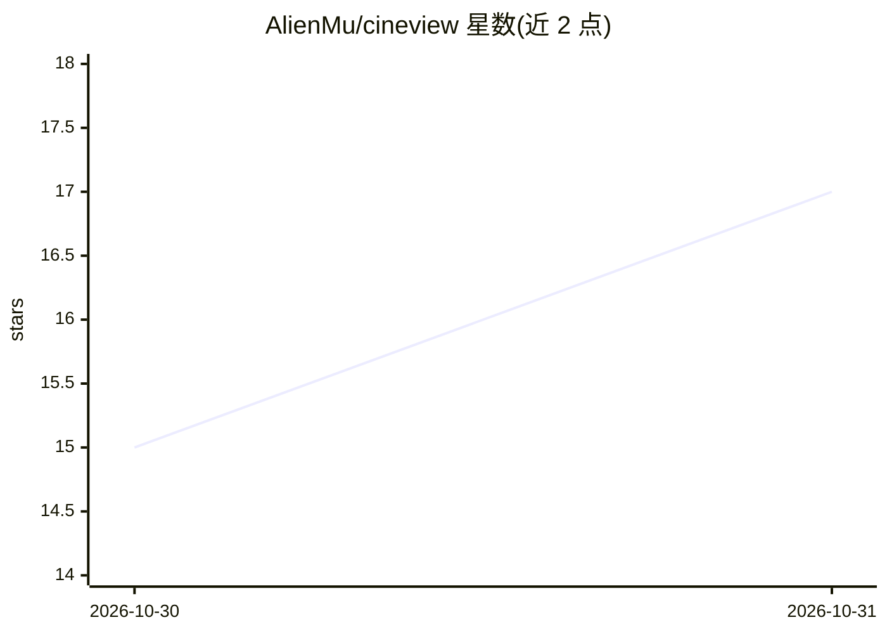

# AlienMu/cineview

⭐ 17 · TypeScript · MIT · 推送 2026-10-29 · [GitHub](https://github.com/AlienMu/cineview) · [官网](https://cineview.pages.dev) · 个人维护 · 中文 README

**无依赖的原生 HTML 落地页框架，附 AI 规划技能与设计参考**

用少量自定义元素（cv-scene、cv-animate、cv-video 等）在纯 HTML 中编写落地页与交互演示：页面拆为场景，各场景有时间线，元素以 fx、duration、after 等属性声明位置，滚动或拖动驱动时间线。无运行时依赖，可在普通 HTML 或 React 等框架页面中使用。面向开发者与 AI 助手协作场景：提供 llms.txt 阅读索引、AI 设计工作流、41 条设计参考及 skills/cineview-design 设计技能（可放入 Claude Code 的 .claude/skills/）。

## 筛选速览

| 维度 | 判定 | 备注 |
|---|---|---|
| AI 角色 | `ai-enhanced` | 去掉 AI 部分产品仍成立 |
| 许可风险 | `permissive` | MIT |
| 部署形态 | `library` | 以包/库形式分发 |
| 模型依赖 | — | README 未给出锁定关系 |
| 硬件要求 | — | 无带数字的原话,不猜 |
| 安装摩擦 | `low` | 无编译、无系统依赖或容器化 |
| 成熟度 | — | 结构信号不足 |

## 能力要点

- 场景+时间线模型，滚动/拖动驱动元素动效（rise/wipe/focus 等预设）
- 零运行时依赖，自定义元素可在纯 HTML 或 React 页面中使用
- cv-video 按时间线逐帧播放视频，支持正放倒放
- 提供 41 条设计参考、32 种布局与 AI 分镜规划技能

## 适用场景

- 编写带滚动叙事的落地页或交互演示
- 让 AI 助手按分镜规划并生成 Cineview 页面
- 在 React 等现有框架项目中加入场景化滚动动画

## 场景标签

 · 领域:前端/网页开发

## 证据(README 行号)

> L23: Cineview writes landing pages and interactive presentations with a handful of custom elements. A page is a series o
> L61: Cineview is written so that an AI assistant can plan and build pages with it. Start from llms.txt, the reading inde
> L70: `skills/cineview-design` has an AI assistant plan the page with you before building it (what it is for, two or thre

## 星数曲线

2026-10-30 15 → 2026-10-31 17（+2）

---
*卡片 v1 · prompt 1.4 · 生成 2026-10-30 · 置信度 high · 依据 README sha `7add38368549` · [字段定义](../../DATASET.md)*
