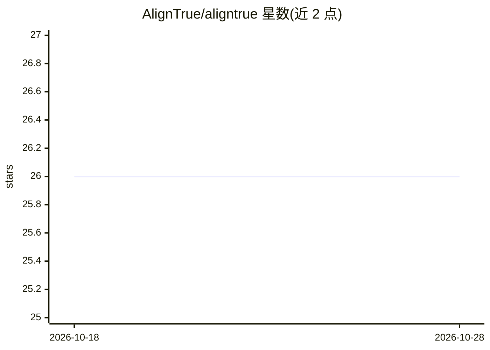

# AlignTrue/aligntrue

⭐ 26 · TypeScript · MIT · 推送 2026-10-23 · [GitHub](https://github.com/AlignTrue/aligntrue) · [官网](https://aligntrue.ai) · 组织维护

**面向 AI agent 的记录与审计平台：留存证据、支持回放**

AlignTrue 定位为 AI 的 system of record，面向在生产环境运行 agent 的团队：留存 agent 的输入、决策与行为证据，提供审计、回滚与确定性恢复能力。设计上强调确定性行为、envelopes-first 与可重建的 projections。当前为 Beta 阶段，API 与契约可能变动；核心流程 local-first，无需云依赖；团队正在内部 dogfooding tasks/notes 场景。README 未提供安装或运行命令，仅列出架构、不变量、轨迹与模拟等文档入口。

## 筛选速览

| 维度 | 判定 | 备注 |
|---|---|---|
| AI 角色 | `ai-ecosystem` | LLM/agent 周边工具 |
| 许可风险 | `permissive` | MIT |
| 部署形态 | `None` |  |
| 模型依赖 | — | README 未给出锁定关系 |
| 硬件要求 | — | 无带数字的原话,不猜 |
| 安装摩擦 | `low` | 无编译、无系统依赖或容器化 |
| 成熟度 | `idea` | |

## 能力要点

- 留存 agent 所见、所做、决策依据的证据链
- 强调确定性行为与可重建 projections
- local-first：核心流程不依赖云服务
- 架构文档覆盖 invariants/trajectories/simulation

## 适用场景

- 生产环境中的 agent 行为审计与责任追溯
- 检测并治理 agent 行为漂移
- 通过回放与回滚实现确定性恢复

## 场景标签

`LLM 可观测性` · 领域:评测与运维

## 证据(README 行号)

> L7: AlignTrue is the system of record for AI. Models commoditize, trust doesn't. We lead with receipts and auditability,
> L11: - **AI without receipts is a liability.** If you can’t prove what it saw, why it decided, and what it did, you can’
> L13: - **If you can’t replay it, you can’t run it.** Real operations need auditability, rollback, and deterministic reco

## 星数曲线

2026-10-18 26 → 2026-10-28 26（+0）

---
*卡片 v1 · prompt 1.4 · 生成 2026-10-26 · 置信度 mid · 依据 README sha `8808b53f6e21` · [字段定义](../../DATASET.md)*
