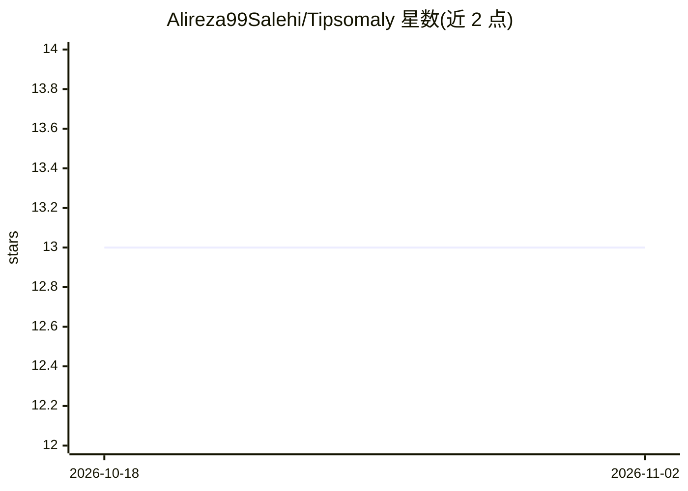

# Alireza99Salehi/Tipsomaly

⭐ 13 · Jupyter Notebook · MIT · 推送 2026-10-27 · [GitHub](https://github.com/Alireza99Salehi/Tipsomaly) · [官网](https://arxiv.org/abs/2602.03594) · 组织维护

**基于 TIPS 视觉语言模型的零样本异常检测 PyTorch 实现**

ICASSP 2026 论文 TIPS Over Tricks 的官方 PyTorch 实现：构建在 TIPS 视觉语言模型之上的零样本异常检测流水线，采用解耦提示（图像级检测用固定提示、像素级定位用可学习提示）并将局部证据注入全局评分，无需 CLIP 特定技巧。提供在 MVTec/VisA 上训练的 checkpoint 下载、Kaggle 一键复现笔记本、requirements.txt 环境安装与 reproduce.sh/train_test.sh 实验脚本，数据集格式遵循 AdaCLIP 仓库约定（需 meta.json）。

## 筛选速览

| 维度 | 判定 | 备注 |
|---|---|---|
| AI 角色 | `ai-native` | 本体是模型或模型工具 |
| 许可风险 | `permissive` | MIT |
| 部署形态 | `library` | 以包/库形式分发 |
| 模型依赖 | — | README 未给出锁定关系 |
| 硬件要求 | — | 无带数字的原话,不猜 |
| 安装摩擦 | `low` | 无编译、无系统依赖或容器化 |
| 成熟度 | — | 结构信号不足 |

## 能力要点

- 基于 TIPS VLM 的空间感知零样本异常检测流水线
- 解耦提示机制：图像级固定提示 + 像素级可学习提示
- 提供 MVTec/VisA 预训练 checkpoint 与 Kaggle 复现笔记本
- 支持在 14 个工业与医学基准上评估

## 适用场景

- 我在无目标域正常数据的场景下做工业图像异常检测
- 我需要像素级异常定位与图像级检测的统一流水线
- 我想在 MVTec/VisA 等基准上复现论文结果

## 场景标签

`目标检测` · 领域:感知与多模态

## 证据(README 行号)

> L10: Official PyTorch implementation of `TIPS Over Tricks: Simple Prompts for Effective Zero-shot Anomaly Detection` — a
> L15: Anomaly detection identifies departures from expected behavior in safety-critical settings. When target-domain norm

## 星数曲线

2026-10-18 13 → 2026-11-02 13（+0）

---
*卡片 v1 · prompt 1.4 · 生成 2026-10-31 · 置信度 high · 依据 README sha `12dad07406e3` · [字段定义](../../DATASET.md)*
