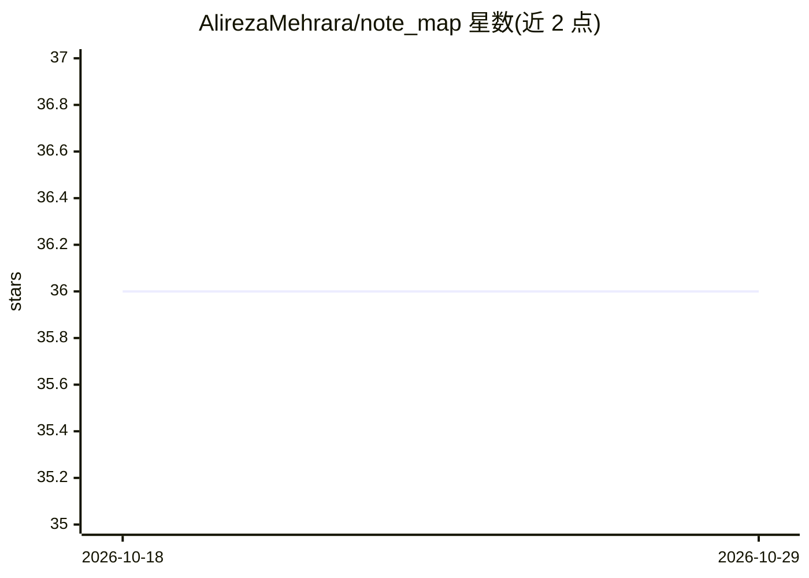

# AlirezaMehrara/note_map

⭐ 36 · Python · MIT · 推送 2026-07-20 · [GitHub](https://github.com/AlirezaMehrara/note_map) · 个人维护

**本地笔记分析工具：聚类整理文本文件并支持与笔记对话**

读取 PDF、TXT、DOCX 等文本文件的应用：按指定簇数对文件聚类分组，支持关键词搜索，可视化组织信息，并提供聊天窗口与笔记对话。本地运行保障隐私，可在设置中选择 TinyLlama 或 Llama2 模型（首次运行时下载）。通过 git clone 源码 + pip 安装依赖 + python main.py 运行。待办清单含会话日志、自动摘要、NER 等未完成项。MIT 许可。

## 筛选速览

| 维度 | 判定 | 备注 |
|---|---|---|
| AI 角色 | `ai-native` | 本体是模型或模型工具 |
| 许可风险 | `permissive` | MIT |
| 部署形态 | `library` | 以包/库形式分发 |
| 模型依赖 | — | README 未给出锁定关系 |
| 硬件要求 | — | 无带数字的原话,不猜 |
| 安装摩擦 | `low` | 无编译、无系统依赖或容器化 |
| 成熟度 | — | 结构信号不足 |

## 能力要点

- PDF/TXT/DOCX 文件的聚类分组与关键词搜索
- 聊天界面与笔记对话（Brainstorming）
- 本地 LLM 支持：TinyLlama / Llama2，模型首次运行时下载

## 适用场景

- 整理大量笔记与文档并发现模式
- 与自己的笔记对话获取想法
- 在本地保护隐私地处理个人知识库

## 场景标签

`知识库管理` · 领域:知识与检索

## 证据(README 行号)

> L12: - Note Interaction: Chat with your notes to stay productive.
> L48: - You can use NoteMap locally to keep your information private. Just select TinyLlama or Llama2 in settings before 

## 星数曲线

2026-10-18 36 → 2026-10-29 36（+0）

---
*卡片 v1 · prompt 1.4 · 生成 2026-10-25 · 置信度 low · 依据 README sha `dd82d33aa774` · [字段定义](../../DATASET.md)*
