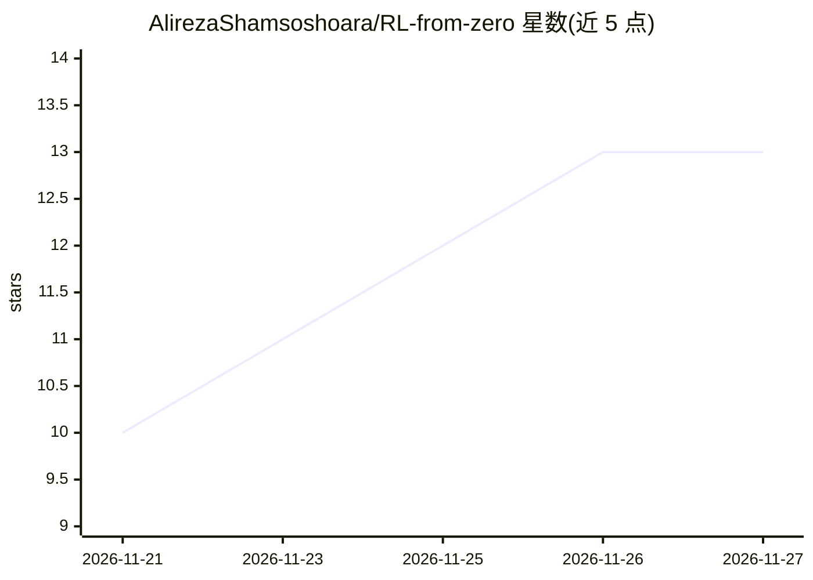

# AlirezaShamsoshoara/RL-from-zero

⭐ 13 · Python · MIT · 推送 2026-11-18 · [GitHub](https://github.com/AlirezaShamsoshoara/RL-from-zero) · 个人维护

**从零实现 13 种强化学习算法的 PyTorch 学习项目**

以教学与练习为目的的强化学习算法合集，覆盖表格法（Q-learning、Nash Q-learning）、值方法（DQN）、策略梯度（PPO、TRPO）、Actor-Critic（A3C、SAC、TD3、DDPG）、离线 RL（IQL）与多智能体方法（MAPPO、MADDPG）。每个算法为独立包，共享 Fire CLI（train/demo）、YAML 配置与可选 W&B 实验跟踪，checkpoint 保存于各算法目录。环境基于 Gymnasium 与 PettingZoo，通过 uv 管理依赖，各算法配有 pytest 测试套件。

## 筛选速览

| 维度 | 判定 | 备注 |
|---|---|---|
| AI 角色 | `ai-native` | 本体是模型或模型工具 |
| 许可风险 | `permissive` | MIT |
| 部署形态 | `desktop` | 安装包/桌面程序 |
| 模型依赖 | — | README 未给出锁定关系 |
| 硬件要求 | — | 无带数字的原话,不猜 |
| 安装摩擦 | `low` | 无编译、无系统依赖或容器化 |
| 成熟度 | — | 结构信号不足 |

## 能力要点

- 13 种算法覆盖表格、值方法、策略梯度、Actor-Critic、离线 RL 与多智能体六类
- 统一的两命令 CLI（train/demo）与 YAML 配置驱动，算法间布局一致
- 可选 Weights & Biases 实验跟踪（CLI 参数、配置或环境变量三种认证方式）
- 各算法独立包并附带覆盖 TD 更新、GAE、checkpoint 等的测试套件

## 适用场景

- 按一致的项目布局对比表格法、值方法与策略梯度算法
- 改一个 YAML 配置快速跑强化学习实验并查看 checkpoint 与指标
- 在此基础上扩展自己的 agent 或接入新环境

## 场景标签

`强化学习` · 领域:训练与推理

## 证据(README 行号)

> L18: RL-from-zero is a collection of reinforcement learning agents implemented from scratch to refresh RL fundamentals a
> L44: All agents expose a two-command Fire CLI (`train` and `demo`), use PyTorch under the hood, and save both periodic a

## 星数曲线

2026-11-21 10 → 2026-11-27 13（+3）

---
*卡片 v1 · prompt 1.4 · 生成 2026-11-21 · 置信度 high · 依据 README sha `aa42d2dc965b` · [字段定义](../../DATASET.md)*
