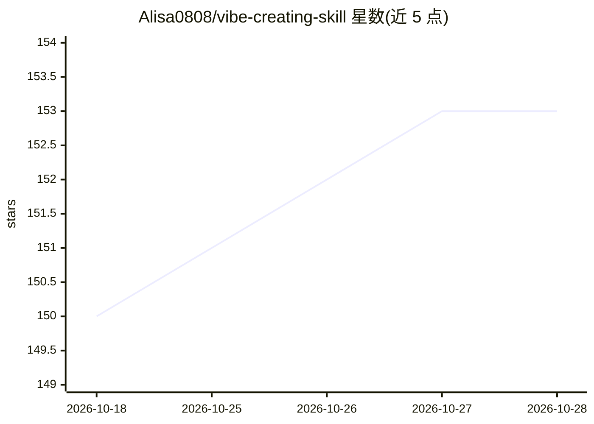

# Alisa0808/vibe-creating-skill

⭐ 153 · JavaScript · NOASSERTION · 推送 2026-06-17 · [GitHub](https://github.com/Alisa0808/vibe-creating-skill) · [官网](https://www.atlascloud.ai?ref=F27PTG) · 个人维护 · 中文 README

**给视频创作者的 AI 文生视频提示词改写技能（Agent Skill）**

以单个 SKILL.md 形式分发的双语提示词工程技能：把粗略想法、故事或过度详细的分镜脚本改写为面向文生视频模型的提示词。采用判断优先机制，按场景×表达×信息三轴打分，先判定输入是否适合该风格，再从直通/轻清理/直接改写/先询问等动作中选择，并以固定四段格式（判断/动作/结果/备注）输出。可运行于 Claude Code、Codex、OpenClaw、Hermes 等遵循 Agent Skills 标准的 agent，也可作为 Cursor 规则或任意 LLM 的系统提示词使用；生成可通过 Atlas Cloud 调用 Seedance 2.0、Kling、Veo 等模型。提供 npx 一键安装与 git clone 两种安装方式。

## 筛选速览

| 维度 | 判定 | 备注 |
|---|---|---|
| AI 角色 | `ai-ecosystem` | LLM/agent 周边工具 |
| 许可风险 | `permissive` | NOASSERTION |
| 部署形态 | `library` | 以包/库形式分发 |
| 模型依赖 | — | README 未给出锁定关系 |
| 硬件要求 | — | 无带数字的原话,不猜 |
| 安装摩擦 | `low` | 无编译、无系统依赖或容器化 |
| 成熟度 | — | 结构信号不足 |

## 能力要点

- 以 SKILL.md 单文件形式分发，兼容 Claude Code / Codex / OpenClaw / Hermes 等标准 agent
- 判断优先：按场景×表达×信息三轴评估输入是否适合，再选择最轻改写动作
- 固定四段输出格式：判断/动作/结果/备注
- 方法论来自 ByteDance/火山引擎随 Seedance 2.0 提出的 Vibe Creating 范式

## 适用场景

- 把模糊的创作想法改写成可用的文生视频提示词
- 将过度技术化的分镜脚本精简为模型友好的提示词
- 在 Claude Code 或其他 agent 中按需调用该提示词改写技能

## 场景标签

`提示工程` · 领域:Agent 开发

## 证据(README 行号)

> L15: **Vibe Creating** is an open-source, bilingual **prompt-engineering skill** that rewrites a rough idea, story, feel
> L21: **Vibe Creating** is that paradigm — introduced by ByteDance / Volcengine alongside the **Seedance 2.0** video-gene

## 星数曲线

2026-10-18 150 → 2026-10-28 153（+3）

---
*卡片 v1 · prompt 1.4 · 生成 2026-10-23 · 置信度 high · 依据 README sha `54b9dbdab31f` · [字段定义](../../DATASET.md)*
