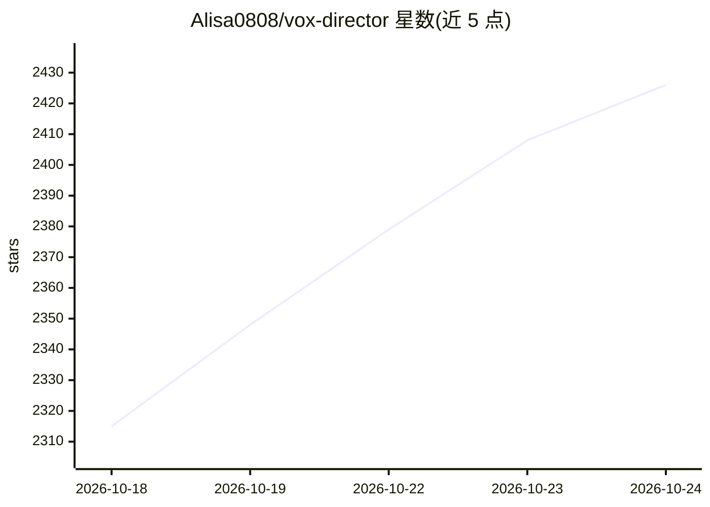

# Alisa0808/vox-director

⭐ 2,426 · Python · MIT · 推送 2026-10-05 · [GitHub](https://github.com/Alisa0808/vox-director) · 个人维护 · 中文 README

**把一句话主题自动做成 Vox 风格拼贴解说视频的 agent 技能**

面向任意编码 agent（Claude Code、Codex 等）的技能（skill）：输入一行主题，经节奏表→拼贴关键帧→动态→配音→配乐→字幕的流水线，调用 Atlas Cloud 上的多款模型（nano-banana-2、gemini-omni-flash、kling、seedance、TTS 等）并用本地 ffmpeg 合成 mp4。支持 B-roll 全自动、A-roll 已有真人视频重绘、C-roll 单照片、Host 数字主持人四种模式，设两处人工确认（节奏表、风格）。需要 Atlas Cloud API key、ffmpeg 与 Python3+Pillow。

## 筛选速览

| 维度 | 判定 | 备注 |
|---|---|---|
| AI 角色 | `ai-native` | 本体是模型或模型工具 |
| 许可风险 | `permissive` | MIT |
| 部署形态 | `library` | 以包/库形式分发 |
| 模型依赖 | — | README 未给出锁定关系 |
| 硬件要求 | — | 无带数字的原话,不猜 |
| 安装摩擦 | `medium` | 含编译或系统依赖之一 |
| 成熟度 | — | 结构信号不足 |

## 能力要点

- 单主题端到端生成含脚本/关键帧/动态/配音/配乐/字幕的 mp4
- 四种输入模式：B-roll 全自动、A-roll 真人视频重绘、C-roll 单照片、Host 数字主持人
- 运行前从 Atlas Cloud API 拉取实时模型列表以应对模型 ID 变化
- 可选本地关键帧引擎做逐帧拼贴动画（无内容过滤）

## 适用场景

- 给自媒体快速生成 Vox 风格科普/广告短视频
- 把已有的真人口播视频重绘成拼贴风格
- 用一张产品照生成以照片为主体的拼贴广告片

## 场景标签

`视频生成` · 领域:内容生成

## 证据(README 行号)

> L7: An **agent skill** that runs end to end on the Atlas Cloud API + local `ffmpeg`, usable by any coding agent (Claude 
> L57: |Job|Model|
> L59: |Keyframe / collage poster|`google/nano-banana-2/text-to-image`|

## 星数曲线

2026-10-18 2,315 → 2026-10-24 2,426（+111）

---
*卡片 v1 · prompt 1.4 · 生成 2026-10-21 · 置信度 mid · 依据 README sha `262617eb1eb7` · [字段定义](../../DATASET.md)*
