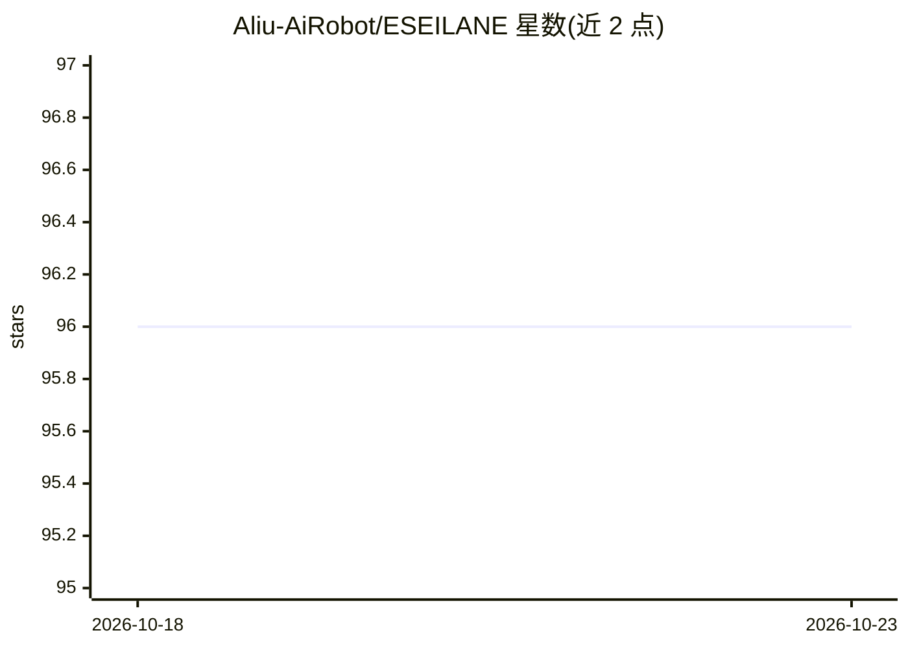

# Aliu-AiRobot/ESEILANE

⭐ 96 · HTML · NOASSERTION · 推送 2026-06-28 · [GitHub](https://github.com/Aliu-AiRobot/ESEILANE) · [官网](https://eseilane.org) · 组织维护

**面向 LLM 与 GraphRAG 的知识图谱引擎（Rust 核心）**

用 Rust 编写的知识图谱数据库引擎，供 LLM、GraphRAG 与 AI 应用存储和查询属性图数据。基于 GraphBLAS 稀疏矩阵代数执行查询，支持 OpenCypher 查询语言，提供分布式架构、多租户、RBAC 与审计日志等企业功能。提供 Docker 镜像、Python SDK（eseilane）与 TypeScript SDK（eseilane-js），内置 GraphRAGClient 可对接 LLM 提供商构建图谱检索管道。基准测试在 AWS r6i.4xlarge 上与 Neo4j、ArangoDB 对比。

## 筛选速览

| 维度 | 判定 | 备注 |
|---|---|---|
| AI 角色 | `ai-ecosystem` | LLM/agent 周边工具 |
| 许可风险 | `none` | NOASSERTION |
| 部署形态 | `self-host` | docker 或自建部署 |
| 模型依赖 | — | README 未给出锁定关系 |
| 硬件要求 | — | 无带数字的原话,不猜 |
| 安装摩擦 | `low` | 无编译、无系统依赖或容器化 |
| 成熟度 | — | 结构信号不足 |

## 能力要点

- 基于 GraphBLAS 稀疏矩阵代数的查询执行
- 属性图模型与 OpenCypher 支持
- GraphRAGClient 集成 LLM 提供商构建检索管道
- 提供 Docker、Python SDK 与 TypeScript SDK

## 适用场景

- 为 GraphRAG 应用存储并查询知识图谱
- 用 Cypher 做多跳关系遍历查询
- 作为 LLM 应用的图数据后端

## 场景标签

`知识图谱` · 领域:知识与检索

## 证据(README 行号)

> L12:  ESEILANE is a next-generation, high-performance Knowledge Graph engine purpose-built for Large Language Models (LL
> L20: |**GraphRAG Native**|First-class integration with LLMs — reduce hallucinations, improve AI accuracy|
> L76: client = GraphRAGClient(db_host="localhost", llm_provider="openai", model="gpt-4o")

## 星数曲线

2026-10-18 96 → 2026-10-23 96（+0）

---
*卡片 v1 · prompt 1.4 · 生成 2026-10-23 · 置信度 high · 依据 README sha `cdd1fb276f84` · [字段定义](../../DATASET.md)*
