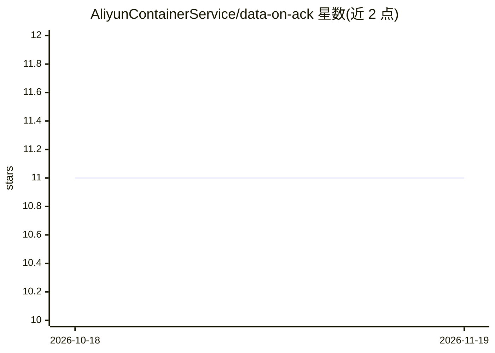

# AliyunContainerService/data-on-ack

⭐ 11 · Go · Apache-2.0 · 推送 2026-11-18 · [GitHub](https://github.com/AliyunContainerService/data-on-ack) · [官网](https://aliyuncontainerservice.github.io/data-on-ack/) · 组织维护 · 中文 README

**面向 ML 工程师的阿里云 ACK 云原生 AI/ML 平台**

基于阿里云容器服务 ACK 的开源云原生 AI/ML 平台，为数据科学家和 ML 工程师提供模型开发、训练、推理的全流程工具。包含运维控制台（用户/配额管理、GPU 监控、数据集管理、模型注册）、开发控制台（Jupyter/VS Code Notebook、PyTorch/TensorFlow 分布式训练、推理服务部署、实验跟踪）、commit-agent gRPC sidecar 与 Notebook CRD 控制器，通过 Helm Charts 部署。前提条件为 ACK Pro 集群、Nginx Ingress Controller 与阿里云 RAM 账号。

## 筛选速览

| 维度 | 判定 | 备注 |
|---|---|---|
| AI 角色 | `ai-ecosystem` | LLM/agent 周边工具 |
| 许可风险 | `permissive` | Apache-2.0 |
| 部署形态 | `library` | 以包/库形式分发 |
| 模型依赖 | — | README 未给出锁定关系 |
| 硬件要求 | — | 无带数字的原话,不猜 |
| 安装摩擦 | `low` | 无编译、无系统依赖或容器化 |
| 成熟度 | — | 结构信号不足 |

## 能力要点

- 运维控制台：用户/配额管理、内嵌 Grafana 的 GPU 集群监控、数据集与模型注册
- 开发控制台：Jupyter/VS Code Notebook 管理、PyTorch/TensorFlow/XGBoost 分布式训练、推理服务部署
- commit-agent：运行在 Notebook Pod 中的 gRPC sidecar，支持 Docker/containerd
- 提供可直接部署的 Helm Charts，预构建镜像已发布

## 适用场景

- 在 ACK 集群上搭建团队的模型开发、训练与推理平台
- 按 ElasticQuotaTree 对多团队做算力配额管理
- 在 Notebook 中发起分布式训练任务并跟踪对比实验

## 场景标签

`MLOps` `模型训练` `推理引擎` · 领域:训练与推理

## 证据(README 行号)

> L3: data-on-ack 是基于阿里云容器服务 ACK 的开源云原生 AI/ML 平台，为数据科学家和 ML 工程师提供模型开发、训练、推理的全流程工具。
> L50: - 分布式训练任务（PyTorch / TensorFlow / XGBoost）
> L65: 可直接部署的 Helm Charts，预构建镜像已发布：

## 星数曲线

2026-10-18 11 → 2026-11-19 11（+0）

---
*卡片 v1 · prompt 1.4 · 生成 2026-11-19 · 置信度 high · 依据 README sha `0dba11c0ece4` · [字段定义](../../DATASET.md)*
