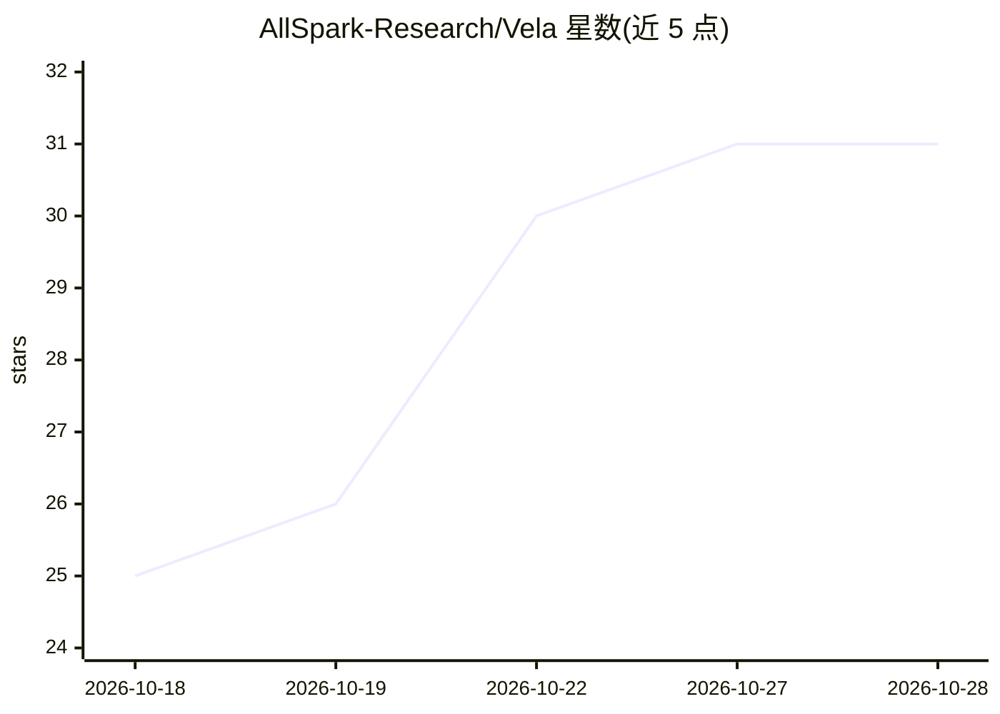

# AllSpark-Research/Vela

⭐ 31 · 推送 2026-10-14 · [GitHub](https://github.com/AllSpark-Research/Vela) · [官网](https://allspark-research.github.io/Vela/) · 组织维护 · 中文 README

**Vela 论文官方仓库：74 个用户行为监督任务模板与提示词**

小红书 AllSpark 团队论文 Vela 的官方仓库：将匿名用户行为历史转化为 LLM 训练任务与轨迹，任务包括预测未来行为、归纳兴趣、用行为证据解释结果。仓库提供论文附录中 91 个模板的精选 74 个（论文研究了 6 类行为、4 种题型），以及中英文 Composer/Scorer 系统提示词。浏览模板无需安装；适配自定义任务时按步骤选择题型、准备匿名化证据、构造题目并按指标或评分规则评测。

## 筛选速览

| 维度 | 判定 | 备注 |
|---|---|---|
| AI 角色 | `ai-knowledge` | 知识聚合/清单类 |
| 许可风险 | `none` | — |
| 部署形态 | `None` |  |
| 模型依赖 | — | README 未给出锁定关系 |
| 硬件要求 | — | 无带数字的原话,不猜 |
| 安装摩擦 | `low` | 无编译、无系统依赖或容器化 |
| 成熟度 | — | 结构信号不足 |

## 能力要点

- 74 个任务模板覆盖 Predictive/Open-prediction/Open/Attribution 四种题型
- 提供中英文 Composer 与 Scorer 系统提示词（论文附录）
- 模板含出题条件、不合格判定、证据边界与种子提示词
- 论文实验：基于约 7.5 万条 Vela-Instruct 样本微调并在十个基准上评测

## 适用场景

- 为用户行为理解任务构造训练数据与评测题
- 复现或改编论文的 Composer/Scorer 评测流程
- 了解行为监督方法在用户建模与 RL 前置训练中的实验设置

## 场景标签

`提示工程` · 领域:Agent 开发

## 证据(README 行号)

> L9: **Official repository for Vela: User Behavior as Supervision Sparks LLM Intelligence, from AllSpark at Xiaohongshu.*
> L15: This repository provides **74 selected task templates** from Vela, organized into four question types. The template

## 星数曲线

2026-10-18 25 → 2026-10-28 31（+6）

---
*卡片 v1 · prompt 1.4 · 生成 2026-10-26 · 置信度 high · 依据 README sha `de27d45d0341` · [字段定义](../../DATASET.md)*
