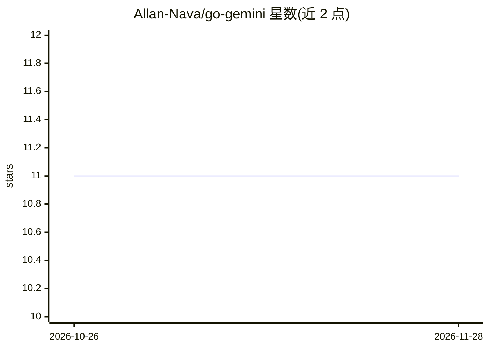

# Allan-Nava/go-gemini

⭐ 11 · Go · MIT · 推送 2026-09-30 · [GitHub](https://github.com/Allan-Nava/go-gemini) · [官网](https://allan-nava.github.io/go-gemini/) · 个人维护

**Go 开发者接入 Gemini API 的零依赖客户端库**

标准库实现的 Go 客户端，封装 Google 官方 Gemini API：提供单轮生成、流式输出、多轮对话、图像/文件输入、JSON schema 输出、安全设置、思考配置、函数调用循环与 token 计数；内置指数退避重试（429/408/5xx）、结构化错误类型与跨主机重定向拒绝的 API key 保护。仅依赖标准库，要求 Go 1.26+，通过 go get 安装，API 自 v1.0.0 起冻结并遵循语义化版本。

## 筛选速览

| 维度 | 判定 | 备注 |
|---|---|---|
| AI 角色 | `ai-ecosystem` | LLM/agent 周边工具 |
| 许可风险 | `permissive` | MIT |
| 部署形态 | `None` |  |
| 模型依赖 | — | README 未给出锁定关系 |
| 硬件要求 | — | 无带数字的原话,不猜 |
| 安装摩擦 | `low` | 无编译、无系统依赖或容器化 |
| 成熟度 | — | 结构信号不足 |

## 能力要点

- 仅用 Go 标准库，模块无第三方依赖
- 支持流式生成、多轮对话与函数调用循环（默认 10 轮上限）
- 内置指数退避重试与可判别重试性的 APIError
- API key 仅经 HTTPS 头发送，拒绝跨主机重定向

## 适用场景

- 在 Go 服务中接入 Gemini 生成与流式回答
- 用函数调用让模型查询自有业务函数
- 需要重试、超时与错误分类可控的 LLM 客户端

## 场景标签

 · 领域:LLM 基础设施/SDK

## 证据(README 行号)

> L6: A small Go client for the official Gemini API. Standard library only:
> L41: `GenerateContent(ctx, prompt)` sends one user prompt; `Generate(ctx, req)` takes a full
> L131: Declare a Go function and let the model call it. `Chat.Send` runs the calls, sends the results back

## 星数曲线

2026-10-26 11 → 2026-11-28 11（+0）

---
*卡片 v1 · prompt 1.4 · 生成 2026-11-19 · 置信度 high · 依据 README sha `34505896aa84` · [字段定义](../../DATASET.md)*
