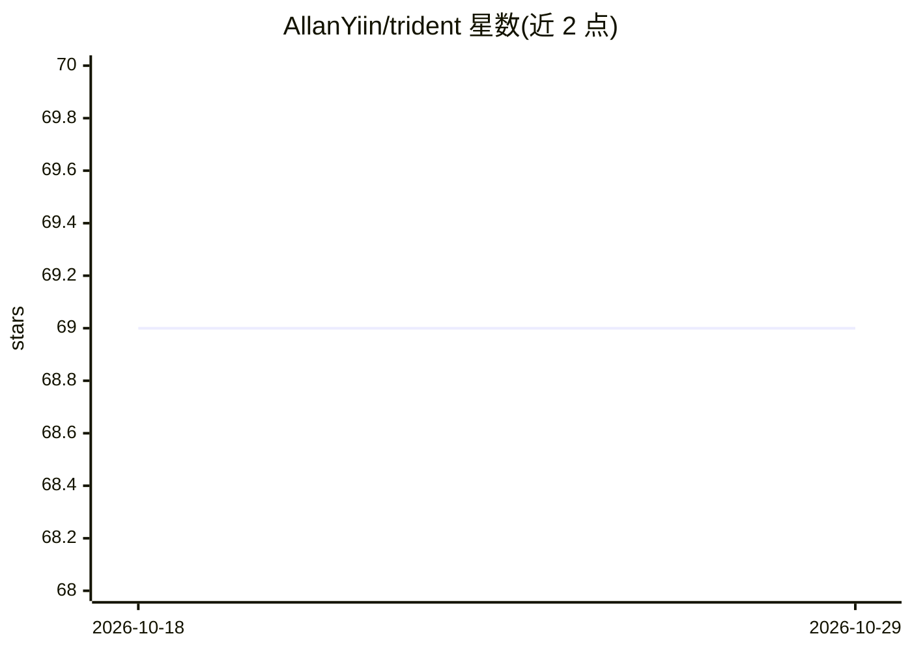

# AllanYiin/trident

⭐ 69 · HTML · MIT · 推送 2026-08-05 · [GitHub](https://github.com/AllanYiin/trident) · 个人维护 · 中文 README

**统一 PyTorch 与 TensorFlow 开发体验的深度学习 API**

基于 PyTorch 和 TensorFlow 的深度学习动态计算图 API（纯 Eager 模式，无 Keras 依赖），目标是在两个后端间提供超过 99% 相同代码的开发体验，并简化深度学习开发者的日常工作。功能覆盖计算机视觉、自然语言理解与强化学习，包括块式网络结构声明、可堆叠的训练计划、自动张量方向转置（CHW/HWC）、自动 padding 计算、数据增强与可视化；提供 Ranger、AdaBelief 等优化器，支持 Transformer/Bert/ViT（PyTorch 后端）与 TensorBoard、MLFlow。

## 筛选速览

| 维度 | 判定 | 备注 |
|---|---|---|
| AI 角色 | `ai-ecosystem` | LLM/agent 周边工具 |
| 许可风险 | `permissive` | MIT |
| 部署形态 | `library` | 以包/库形式分发 |
| 模型依赖 | — | README 未给出锁定关系 |
| 硬件要求 | — | 无带数字的原话,不猜 |
| 安装摩擦 | `low` | 无编译、无系统依赖或容器化 |
| 成熟度 | `idea` | |

## 能力要点

- 同一代码在 PyTorch 与 TensorFlow 后端运行（超过 99% 相同代码，无 Keras 依赖）
- 块式组件（如 Conv2d_Block 整合卷积/归一化/激活/Dropout/噪音）与自动 padding
- 积木式训练计划（Training Plan）与 fluent 风格语法
- 内置 Ranger/Lars/AdaBelief 等优化器与数据增强、可视化组件

## 适用场景

- 编写一套模型代码同时跑 PyTorch 和 TensorFlow 后端
- 用块式结构与训练计划快速搭建 CV/NLP/强化学习模型
- 在训练流程中插入评估、可视化与算力耗用监控

## 场景标签

 · 领域:深度学习/框架

## 证据(README 行号)

> L8: **Trident** is a deep learning dynamic calculation graph api based on PyTorch and TensorFlow (pure Eager mode, no Ke
> L10: **Trident** 是基於PyTorch和TensorFlow的深度學習動態計算圖API（純Eager模式，無Keras依賴）。 通過Trident，您不僅可以在PyTorch和Tensorflow中使用相同的開發經驗（超過9

## 星数曲线

2026-10-18 69 → 2026-10-29 69（+0）

---
*卡片 v1 · prompt 1.4 · 生成 2026-10-24 · 置信度 high · 依据 README sha `b713799572e5` · [字段定义](../../DATASET.md)*
