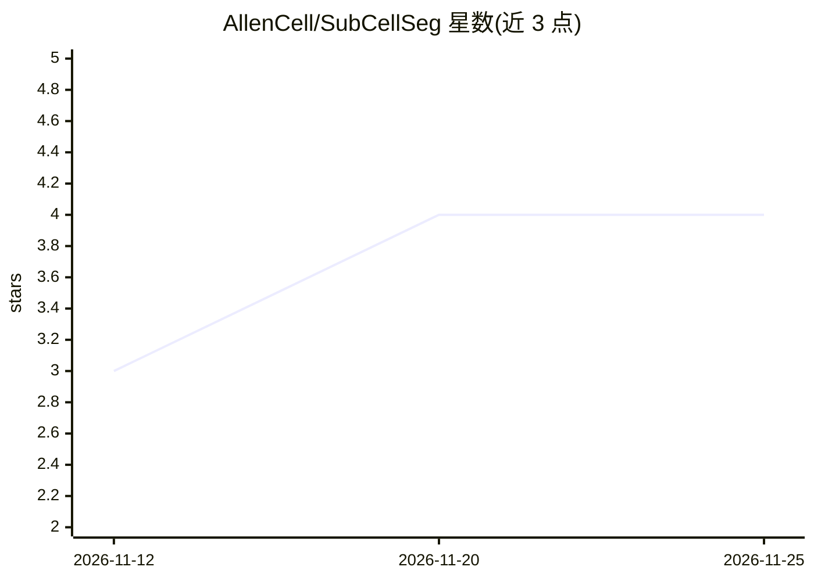

# AllenCell/SubCellSeg

⭐ 4 · Python · BSD-3-Clause · 推送 2026-11-11 · [GitHub](https://github.com/AllenCell/SubCellSeg) · 组织维护

**荧光显微图像的单一 3D 亚细胞结构分割模型工具**

面向荧光显微镜图像的预训练 3D 分割模型，在 13 种内源标记的亚细胞结构上联合训练，无需知道图像中是哪种结构，输入 z-stack 输出二值 3D 掩码。可通过 CLI 直接对新图像推理，也支持用自己的图像与掩码微调，或从 Python、napari、Fiji 调用，前两种无需编程。模型约 65 MB 首次运行自动下载；输出为语义掩码而非实例分割，计数需后处理。

## 筛选速览

| 维度 | 判定 | 备注 |
|---|---|---|
| AI 角色 | `ai-native` | 本体是模型或模型工具 |
| 许可风险 | `permissive` | BSD-3-Clause |
| 部署形态 | `None` |  |
| 模型依赖 | — | README 未给出锁定关系 |
| 硬件要求 | — | 无带数字的原话,不猜 |
| 安装摩擦 | `medium` | 含编译或系统依赖之一 |
| 成熟度 | — | 结构信号不足 |

## 能力要点

- 单一模型覆盖 13 种亚细胞结构，输入不含结构类型信息
- CLI 一条命令推理，支持 TIFF/OME-TIFF（CZI/ND2/OME-Zarr 需额外安装步骤）
- 支持用自有数据微调，README 给出微调后 Dice 提升的实例
- 提供 Python API、napari 插件与 Fiji 插件（插件仍在开发中）

## 适用场景

- 对荧光 z-stack 图像直接生成亚细胞结构 3D 掩码
- 训练数据掩码约定与模型不同时微调模型
- 在 napari 或 Fiji 中可视化叠加分割结果

## 场景标签

`目标检测` `微调` · 领域:感知与多模态

## 证据(README 行号)

> L8: SubCellSeg is a single 3D segmentation model for subcellular structures in
> L18: output a binary 3D mask.
> L90: subcellseg predict --input my_images --output results

## 星数曲线

2026-11-12 3 → 2026-11-25 4（+1）

---
*卡片 v1 · prompt 1.4 · 生成 2026-11-21 · 置信度 high · 依据 README sha `a1b687003ce9` · [字段定义](../../DATASET.md)*
