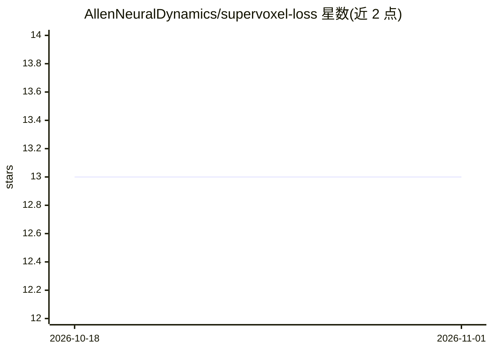

# AllenNeuralDynamics/supervoxel-loss

⭐ 13 · Python · MIT · 推送 2026-04-21 · [GitHub](https://github.com/AllenNeuralDynamics/supervoxel-loss) · 组织维护

**神经网络的连通性保持损失函数，用于管状结构实例分割**

AAAI 2025 论文的官方实现：提供一种监督体素（supervoxel）损失函数，用于训练执行实例分割的神经网络。机制是对神经网络预测二值化后，与真值比较得到假阳性/假阴性掩码，在其中检测连通分量，识别导致连通性错误的关键（critical）supervoxel 并施加更高惩罚，从而改善管状结构分割。面向计算机视觉/深度学习研究者，以 PyTorch 训练示例形式给出用法，MIT 许可。

## 筛选速览

| 维度 | 判定 | 备注 |
|---|---|---|
| AI 角色 | `ai-native` | 本体是模型或模型工具 |
| 许可风险 | `permissive` | MIT |
| 部署形态 | `library` | 以包/库形式分发 |
| 模型依赖 | — | README 未给出锁定关系 |
| 硬件要求 | — | 无带数字的原话,不猜 |
| 安装摩擦 | `low` | 无编译、无系统依赖或容器化 |
| 成熟度 | — | 结构信号不足 |

## 能力要点

- 结构级与体素级双重惩罚的连通性保持损失
- 通过假阳/假阴掩码中的连通分量检测关键 supervoxel
- 提供 PyTorch 训练用法示例

## 适用场景

- 训练分割管状结构（如神经元）的神经网络
- 在实例分割任务中惩罚连通性错误
- 复现或引用 AAAI 2025 论文方法

## 场景标签

`目标检测` · 领域:感知与多模态

## 证据(README 行号)

> L12: This repository implements a connectivity-preserving loss function that improves segmentation of curvilinear struct
> L15: @inproceedings{grim2025,

## 星数曲线

2026-10-18 13 → 2026-11-01 13（+0）

---
*卡片 v1 · prompt 1.4 · 生成 2026-10-31 · 置信度 high · 依据 README sha `74b0137ef3e4` · [字段定义](../../DATASET.md)*
