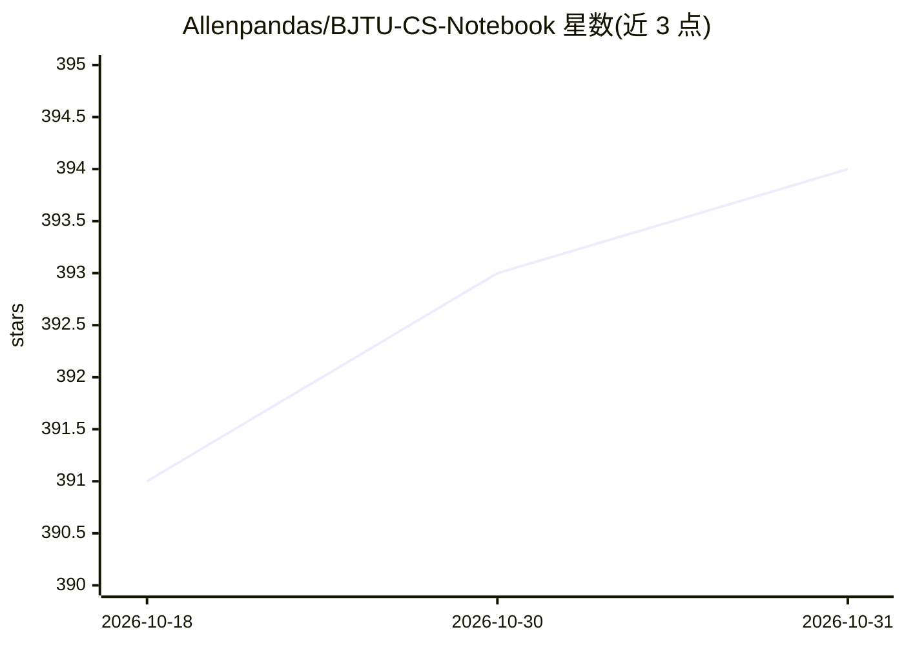

# Allenpandas/BJTU-CS-Notebook

⭐ 394 · Jupyter Notebook · NOASSERTION · 推送 2025-12-23 · [GitHub](https://github.com/Allenpandas/BJTU-CS-Notebook) · 个人维护 · 中文 README

**北交大计算机学院研究生课程资料与考试整理合集**

由个人维护的北京交通大学计算机科学与技术学院研究生课程资料仓库：收录约 20 门硕博课程的课件、作业参考、期末资料与实验报告模版，另含博士生资格考试历年试题及科研、求职相关资料，以课程编号/名称/学期/类型表格组织。资料部分来自其他同学贡献并在各学科文件夹内注明。默认采用 CC BY-NC-SA 4.0 许可，声明仅供学习交流、内容正确性不做保证，非营利永久免费。

## 筛选速览

| 维度 | 判定 | 备注 |
|---|---|---|
| AI 角色 | `ai-knowledge` | 知识聚合/清单类 |
| 许可风险 | `none` | NOASSERTION |
| 部署形态 | `None` |  |
| 模型依赖 | — | README 未给出锁定关系 |
| 硬件要求 | — | 无带数字的原话,不猜 |
| 安装摩擦 | `low` | 无编译、无系统依赖或容器化 |
| 成熟度 | — | 结构信号不足 |

## 能力要点

- 约 20 门硕博课程的课件/作业/期末资料归档
- 含博士生资格考试历年试题
- 课程以编号、学期、硕博类型的表格形式组织
- 默认 CC BY-NC-SA 4.0 许可并注明贡献者署名

## 适用场景

- 北交大计算机研究生查找课程资料与期末复习材料
- 备考博士生资格考试时查阅历年试题
- 参考实验报告模版与作业思路

## 场景标签

`教程课程` · 领域:学习与行业

## 证据(README 行号)

> L3: 本项目分享了北京交通大学计算机科学与技术学院（原"计算机与信息技术学院"）研究生期间的课程资料、笔记、回忆和整理的**期末考试**、**课程作业参考**、**实验报告模版**以及**科研**或**企业求职**等等相关资料。本仓库为非
> L11: |课程编号|课程名称|开设学期|类型|课件|作业|期末资料|

## 星数曲线

2026-10-18 391 → 2026-10-31 394（+3）

---
*卡片 v1 · prompt 1.4 · 生成 2026-10-21 · 置信度 high · 依据 README sha `8387a2842347` · [字段定义](../../DATASET.md)*
