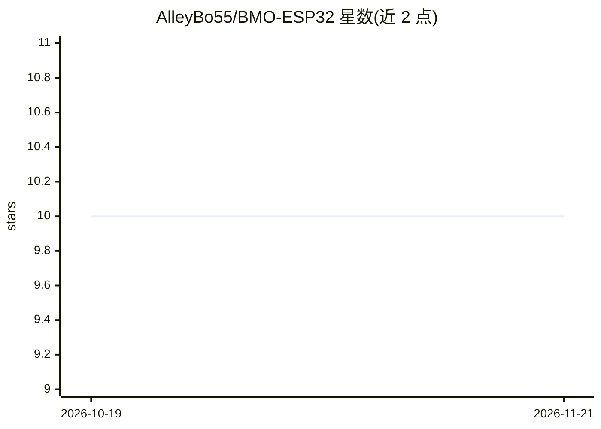

# AlleyBo55/BMO-ESP32

⭐ 10 · TypeScript · MIT · 推送 2026-09-30 · [GitHub](https://github.com/AlleyBo55/BMO-ESP32) · [官网](https://bmo-esp-32.vercel.app) · 个人维护

**给爱好者的 ESP32 语音对话玩具：说话即云端回答**

基于 ESP32-C3 与 1.8 寸 ST7735 屏的开源 BMO 机器人：屏幕动画、触摸反应、I2S 音频输出；按住触摸传感器说话后经 STT→LLM→TTS 流水线生成语音回答，支持对话记忆、唇形同步与心情表情。云端部分为 Next.js 仪表盘，经 OpenRouter 调用模型，记忆层借鉴 GBrain 用 Supabase pgvector 实现；所有大脑功能可降级为 no-op，非硬依赖。固件可用 PlatformIO 编译或直接刷预编译二进制。

## 筛选速览

| 维度 | 判定 | 备注 |
|---|---|---|
| AI 角色 | `ai-enhanced` | 去掉 AI 部分产品仍成立 |
| 许可风险 | `permissive` | MIT |
| 部署形态 | `library` | 以包/库形式分发 |
| 模型依赖 | locked-api |  |
| 硬件要求 | — | 无带数字的原话,不猜 |
| 安装摩擦 | `medium` | 含编译或系统依赖之一 |
| 成熟度 | — | 结构信号不足 |

## 能力要点

- 按住即说的语音对话：STT→LLM→TTS 全流程经 /api/brain 路由
- 借鉴 GBrain 的记忆层：pgvector 持久记忆、知识图谱、睡眠整理周期
- 25 种心情动画与基于音频包络的实时唇形同步
- 预编译固件可直接用 esptool 刷入，无需工具链

## 适用场景

- 自己动手焊一台能对话的桌面陪伴机器人
- 给孩子或自己做一个有记忆、有性格的语音玩具
- 学习 ESP32 固件与云端 LLM 服务的端云架构

## 场景标签

`语音 Agent` · 领域:对话与助手

## 证据(README 行号)

> L22: Hold the touch sensor, speak, and let go. BMO captures your voice, ships it to the cloud brain, and answers out lou
> L51: The brain is always an **enhancement, never a hard dependency**: every function degrades to a safe no-op and logs a
> L94: A complete, hackable BMO — face animation, voice, touch reactions, pre-baked sound clips — built from a small handf

## 星数曲线

2026-10-19 10 → 2026-11-21 10（+0）

---
*卡片 v1 · prompt 1.4 · 生成 2026-11-20 · 置信度 high · 依据 README sha `91758cc21232` · [字段定义](../../DATASET.md)*
