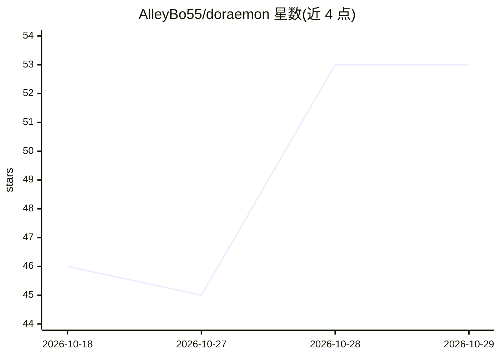

# AlleyBo55/doraemon

⭐ 53 · TypeScript · 推送 2026-10-28 · [GitHub](https://github.com/AlleyBo55/doraemon) · 个人维护

**Shimeji 风格哆啦A梦桌面宠物，接入 AI 记忆与对话**

基于 Electron 的桌面吉祥物应用，提供物理行为的行走、攀爬、25+ 情绪动画与渐进待机状态；通过集成 OpenClaw 接入 Claude 实现聊天、记忆系统（RAG 召回）与自我学习，并可对 VS Code、Cursor、Zed 的编码活动做出反应。另含 Kiro 桌面伴侣扩展（792KB 原生 Rust companion，监听 33 种编辑器信号）与 Kiro Gateway 本地隧道（经 Kiro 会话路由 Claude Opus 4.7/Haiku 4.5 调用，无需 api.anthropic.com）。跨 macOS/Windows/Linux，从源码 npm 安装运行；集成功能依赖 OpenClaw/Kiro 会话。

## 筛选速览

| 维度 | 判定 | 备注 |
|---|---|---|
| AI 角色 | `ai-enhanced` | 去掉 AI 部分产品仍成立 |
| 许可风险 | `none` | — |
| 部署形态 | `library` | 以包/库形式分发 |
| 模型依赖 | — | README 未给出锁定关系 |
| 硬件要求 | — | 无带数字的原话,不猜 |
| 安装摩擦 | `low` | 无编译、无系统依赖或容器化 |
| 成熟度 | `idea` | |

## 能力要点

- 物理驱动的 Shimeji 桌面行为与 139 帧透明精灵动画（20 种情绪状态）
- OpenClaw 集成 + 记忆系统（RAG 召回、自学习）与多模型支持
- Kiro Gateway 经本地 Kiro 会话路由 Claude Opus 4.7/Haiku 4.5，免 API key
- Kiro Coding Companion 扩展仅 792KB，监听 33 种编辑器信号，离线运行

## 适用场景

- 桌面养一只会走动、有情绪反应的哆啦A梦宠物
- 编码时获得对保存/报错/提交等活动有反应的桌面伴侣
- 通过聊天界面与带记忆的 AI 伴侣对话

## 场景标签

`AI 助手` `聊天机器人` · 领域:对话与助手

## 证据(README 行号)

> L5:  A Shimeji-style desktop mascot powered by OpenClaw — your AI companion that lives freely on your screen!
> L139: - 🧠 **OpenClaw integration** — Powered by Claude, reacts to AI events in real-time

## 星数曲线

2026-10-18 46 → 2026-10-29 53（+7）

---
*卡片 v1 · prompt 1.4 · 生成 2026-10-25 · 置信度 high · 依据 README sha `ea80b2e3e21c` · [字段定义](../../DATASET.md)*
