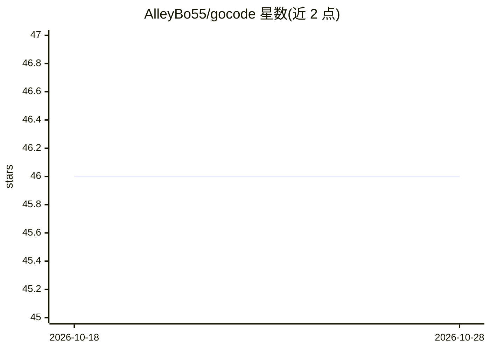

# AlleyBo55/gocode

⭐ 46 · Go · MIT · 推送 2026-09-24 · [GitHub](https://github.com/AlleyBo55/gocode) · 个人维护

**Go 编写的开源终端 AI 编码 agent 运行时，单二进制支持任意模型**

用 Go 从零实现的终端 AI 编码 agent：单 12MB 二进制、无运行时依赖，通过 `go install` 安装。提供多 agent 编排（最多 5 个并发后台 agent、4 种内置子 agent 角色）、跨会话记忆与自动整理的 dream 系统、LSP 与 AST-grep 工具、MCP server/client、WebSocket IDE 桥接（VS Code/Cursor/Kiro/Antigravity）、cron 调度、Git checkpoint、16 个内置技能等。支持 11 个 provider、200+ 模型，含 OpenRouter 单 key 访问与 Ollama/LM Studio 本地推理。限制：以 CLI/TUI 交互为主，需自备模型或 API key（本地路径除外）。

## 筛选速览

| 维度 | 判定 | 备注 |
|---|---|---|
| AI 角色 | `ai-ecosystem` | LLM/agent 周边工具 |
| 许可风险 | `permissive` | MIT |
| 部署形态 | `desktop` | 安装包/桌面程序 |
| 模型依赖 | local-ok | 支持本地模型 |
| 硬件要求 | — | 无带数字的原话,不猜 |
| 安装摩擦 | `low` | 无编译、无系统依赖或容器化 |
| 成熟度 | — | 结构信号不足 |

## 能力要点

- 单 12MB Go 二进制，无 Python/Node 依赖，支持 11 个 provider、200+ 模型
- 多 agent 编排：最多 5 个并发后台 agent 与 agent 间消息通信
- MCP 协议兼容（server/client），WebSocket 桥接 VS Code/Cursor/Kiro/Antigravity
- `--max-cost` 花费上限与 `/cost` 分模型成本账本，`gocode doctor` 探测模型能力

## 适用场景

- 在终端用任意模型（含 Ollama 本地模型）做 AI 辅助编码
- 通过 MCP server 模式接入 Cursor/VS Code/Kiro 等 IDE
- 设置花费上限后无人值守运行编码任务

## 场景标签

`编码 Agent` `多智能体` · 领域:Agent 开发

## 证据(README 行号)

> L13:  gocode — The Open-Source Claude Code Alternative. Built in Go. Works With Any Model.
> L63: The result: a single 12MB binary that starts in under 10 milliseconds, works with 200+ models across 11 providers, 
> L127: |**MCP Server Mode**|Plug into Cursor, Kiro, VS Code, Antigravity, or Claude Desktop.|`gocode mcp-serve`|

## 星数曲线

2026-10-18 46 → 2026-10-28 46（+0）

---
*卡片 v1 · prompt 1.4 · 生成 2026-10-25 · 置信度 mid · 依据 README sha `2265b5561e14` · [字段定义](../../DATASET.md)*
