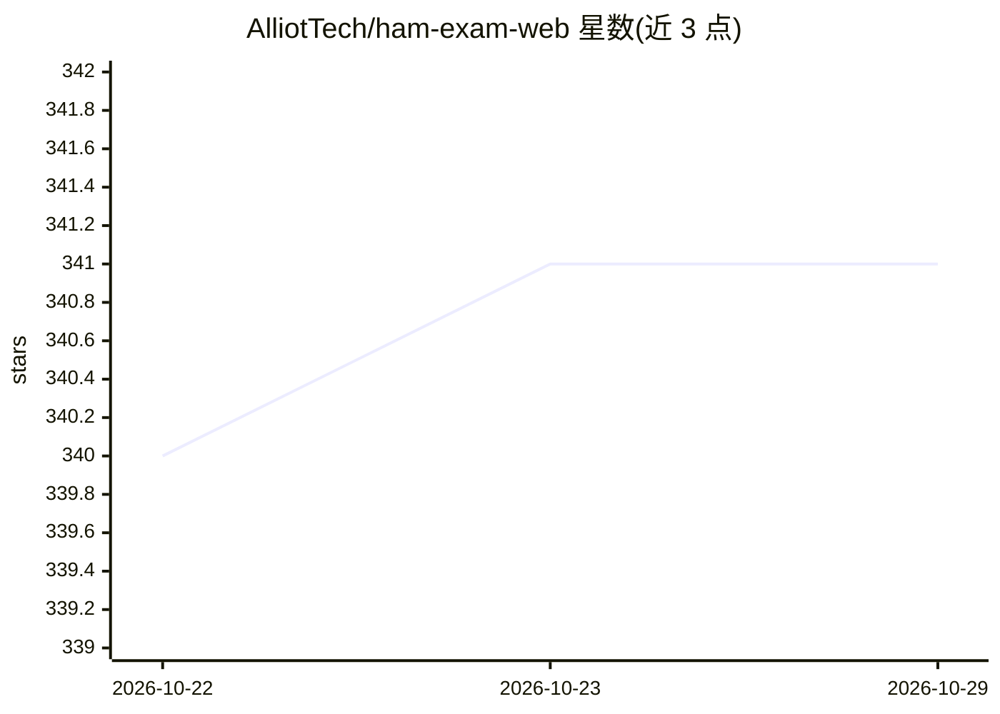

# AlliotTech/ham-exam-web

⭐ 341 · TypeScript · 推送 2026-10-20 · [GitHub](https://github.com/AlliotTech/ham-exam-web) · [官网](https://ham-exam.iots.vip) · 个人维护 · 中文 README

**业余无线电执照考试模拟应用，A/B/C 类题库练习与模拟**

基于 2025 年题库（全库 1375 题）的业余无线电执照考试 Web 应用，面向备考 A/B/C 三类考试的用户：提供按真实规则抽题、计时的模拟考试，顺序/随机练习模式，题号与关键词搜索，以及报名照片尺寸调整工具。练习中附带 AI 生成的答案解析与记忆助记。采用 Next.js 16 + React 19 技术栈，支持 PWA 离线使用，所有数据存于浏览器 localStorage。首次运行需执行脚本构建题库数据集，数据来源可为本地文件或远程仓库。

## 筛选速览

| 维度 | 判定 | 备注 |
|---|---|---|
| AI 角色 | `ai-enhanced` | 去掉 AI 部分产品仍成立 |
| 许可风险 | `none` | — |
| 部署形态 | `library` | 以包/库形式分发 |
| 模型依赖 | — | README 未给出锁定关系 |
| 硬件要求 | — | 无带数字的原话,不猜 |
| 安装摩擦 | `low` | 无编译、无系统依赖或容器化 |
| 成熟度 | — | 结构信号不足 |

## 能力要点

- A/B/C 三类模拟考试，真实规则抽题、计时交卷与成绩统计
- 练习模式附 AI 生成的答案解析与记忆助记（1375 题）
- PWA 离线可用，数据仅存浏览器 localStorage
- 附报名照片尺寸调整工具

## 适用场景

- 备考业余无线电 A/B/C 类执照时刷题与模拟考试
- 离线环境（如移动设备 PWA）中练习题库
- 处理执照报名所需的证件照尺寸

## 场景标签

`图像视频处理` · 领域:感知与多模态

## 证据(README 行号)

> L7: 基于最新2025年题库的业余无线电执照考试模拟应用，支持A/B/C三类考试，提供完整的模拟考试、智能化练习、**AI 生成的答案解析与助记**、关键词搜索、报名照片处理等功能，采用Next.js 16 + React 19技术栈，支
> L15: - **🎯 练习模式**：顺序/随机练习，进度保存，AI 生成的答案解析与记忆助记（全库 1375 题）

## 星数曲线

2026-10-22 340 → 2026-10-29 341（+1）

---
*卡片 v1 · prompt 1.4 · 生成 2026-10-21 · 置信度 mid · 依据 README sha `3d8db761fb39` · [字段定义](../../DATASET.md)*
