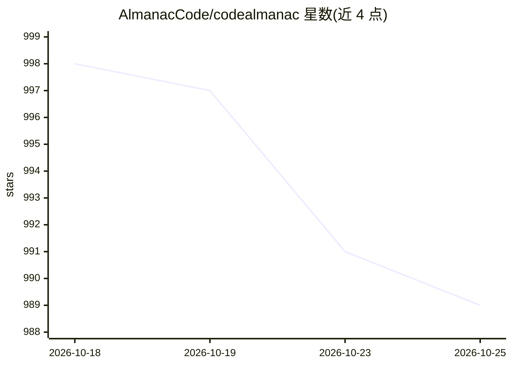

# AlmanacCode/codealmanac

⭐ 989 · TypeScript · Apache-2.0 · 推送 2026-07-25 · [GitHub](https://github.com/AlmanacCode/codealmanac) · [官网](https://codealmanac.com) · 组织维护

**给 AI 编码代理维护的代码库 wiki：沉淀决策、流程与陷阱**

在代码仓库内维护纯 markdown wiki 的 CLI 工具，由 Codex 或 Claude Code 代理生成与维护内容：从文件、Git diff、PR/issue、URL 及本地代理对话记录中提取知识写入 almanac/ 目录，并定期执行 garden 任务清理陈旧、重复或链接薄弱的页面。通过本地 macOS launchd 定时任务自动同步，提供终端搜索/show 命令与只读本地 web 查看器。所有数据本地存储。当前仅支持 macOS 与 Python 3.12+，需 Codex 或 Claude Code 可用且已认证；旧 npm 发行版已停用，PyPI 为唯一分发渠道。

## 筛选速览

| 维度 | 判定 | 备注 |
|---|---|---|
| AI 角色 | `ai-ecosystem` | LLM/agent 周边工具 |
| 许可风险 | `permissive` | Apache-2.0 |
| 部署形态 | `library` | 以包/库形式分发 |
| 模型依赖 | locked-api |  |
| 硬件要求 | — | 无带数字的原话,不猜 |
| 安装摩擦 | `low` | 无编译、无系统依赖或容器化 |
| 成熟度 | — | 结构信号不足 |

## 能力要点

- wiki 为仓库内纯 markdown，随 Git 审查
- ingest 支持文件、diff、PR/issue、URL、本地对话记录等多源输入
- launchd 定时 Sync/Garden/Update 自动维护，全程本地运行
- 通过 almanac-yoke 单一提供方边界复用 Codex/Claude OAuth 会话

## 适用场景

- 让 AI 编码代理在编码时查阅代码无法表达的设计决策与陷阱
- 自动从代理对话与 PR 中沉淀持久知识到仓库 wiki
- 定期维护 wiki 图谱，清理陈旧与重复内容

## 场景标签

`知识库管理` · 领域:知识与检索

## 证据(README 行号)

> L13: A living wiki for your codebase, maintained by AI coding agents.
> L15: CodeAlmanac gives AI agents the context code alone cannot hold: why a system is
> L202: CodeAlmanac uses `almanac-yoke` as its single provider boundary. Codex runs

## 星数曲线

2026-10-18 998 → 2026-10-25 989（-9）

---
*卡片 v1 · prompt 1.4 · 生成 2026-10-21 · 置信度 mid · 依据 README sha `7fabd47f0bc2` · [字段定义](../../DATASET.md)*
