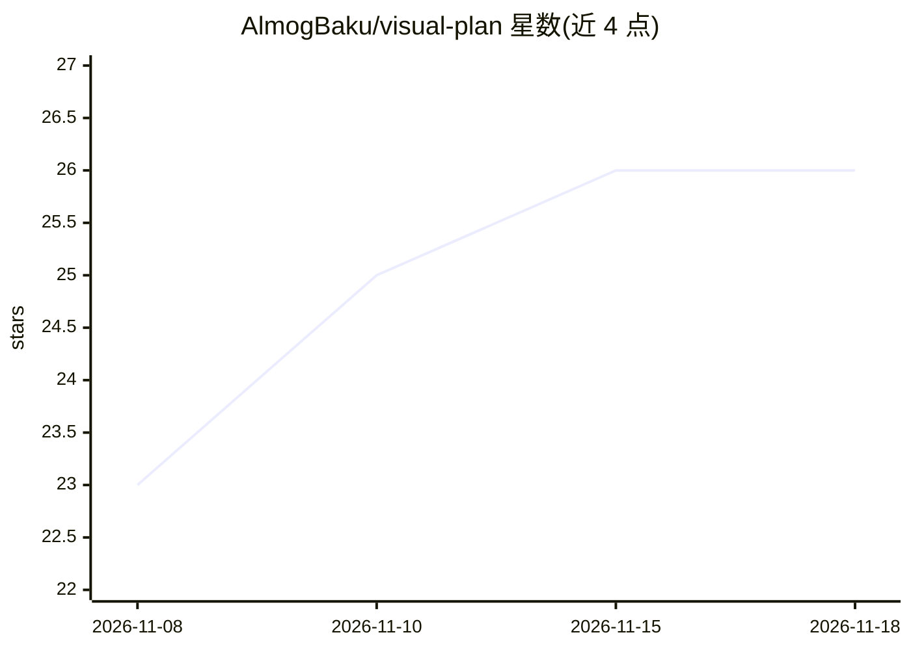

# AlmogBaku/visual-plan

⭐ 26 · JavaScript · Apache-2.0 · 推送 2026-11-04 · [GitHub](https://github.com/AlmogBaku/visual-plan) · 个人维护

**Agent 技能：把一次变更的设计写成单页可交互决策页并锁定**

面向 Claude Code、Codex 等编码 agent 的技能包（SKILL.md 形式）：让 agent 读取变更涉及的代码后，在子代理中生成单个自包含 plan.html——含可缩放的目标设计图、以控件形式呈现的待定决策、Respond/Lock 交互。锁定后才生成实现计划。文本遵循 ASD-STE100 简化技术英语并由包内置 lint 检查。仅需 Node.js，解析器已内置，无需 npm install。输出单文件、无网络无框架依赖。

## 筛选速览

| 维度 | 判定 | 备注 |
|---|---|---|
| AI 角色 | `ai-ecosystem` | LLM/agent 周边工具 |
| 许可风险 | `permissive` | Apache-2.0 |
| 部署形态 | `library` | 以包/库形式分发 |
| 模型依赖 | — | README 未给出锁定关系 |
| 硬件要求 | — | 无带数字的原话,不猜 |
| 安装摩擦 | `low` | 无编译、无系统依赖或容器化 |
| 成熟度 | — | 结构信号不足 |

## 能力要点

- 生成单个自包含 plan.html：设计图缩放 + 决策控件 + Respond/Lock
- 由子代理构建页面，YAML/HTML/lint 过程不进入主会话上下文
- 内容遵循 ASD-STE100 简化技术英语，包内 lint 检查
- 仅需 Node.js，js-yaml 已内置，无需额外安装依赖

## 适用场景

- 让编码 agent 为一次代码变更产出可交互的设计决策页
- 在设计阶段集中回答开放决策，锁定后再生成实现计划
- 其他规划类技能调用它生成可交互 brief

## 场景标签

`AI 写作` · 领域:内容生成

## 证据(README 行号)

> L5: Agent Skill
> L18: yours are buried on page 7. **visual-plan** is an agent skill that writes the design for one change as a
> L29: - **Built in a subagent.** The page builder writes, packs, and lints the page in its own context and returns only a

## 星数曲线

2026-11-08 23 → 2026-11-18 26（+3）

---
*卡片 v1 · prompt 1.4 · 生成 2026-11-18 · 置信度 high · 依据 README sha `0851b2a94da6` · [字段定义](../../DATASET.md)*
