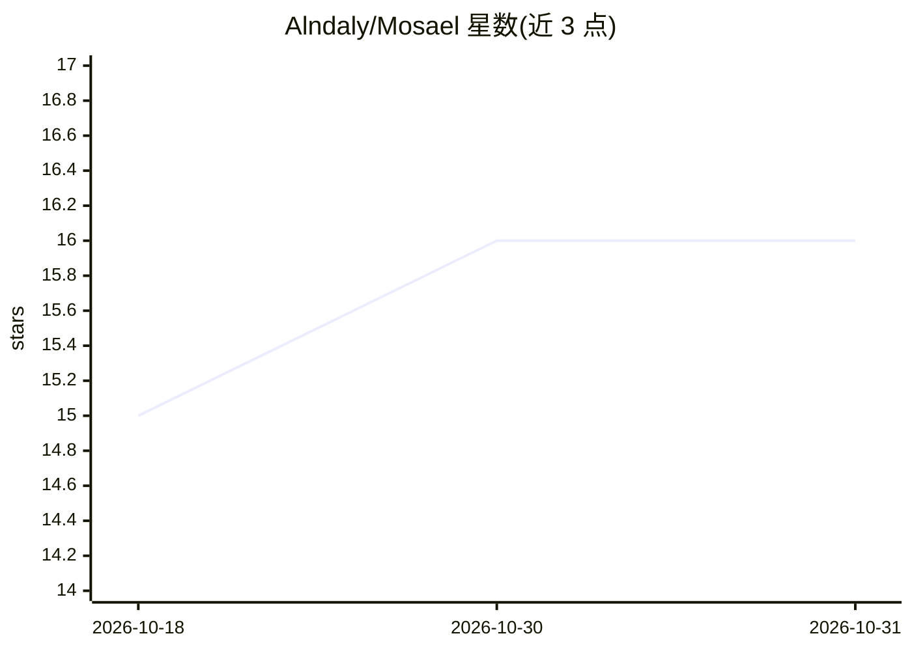

# Alndaly/Mosael

⭐ 16 · Python · NOASSERTION · 推送 2026-10-30 · [GitHub](https://github.com/Alndaly/Mosael) · [官网](https://mosael.com) · 个人维护 · 中文 README

**本地优先的桌面 AI 视频创作软件：生成、剪辑、配音一站式**

面向 Mac/Windows 的 Electron 桌面应用，覆盖文本到视频/图像/音乐生成、多轨时间线剪辑与字幕、本地声音克隆与配音对口型、数字人说话视频、3D 预演与 Blender 交换、节点式工作流自动化，以及发布到抖音/B站等平台。模型能力来自用户自带的 API key（Seedance、Kling、Veo、Wan 等）或本机/LAN 的 ComfyUI 服务器，项目与媒体默认保存在本地。提供 macOS/Windows 安装包，个人非商业使用免费。

## 筛选速览

| 维度 | 判定 | 备注 |
|---|---|---|
| AI 角色 | `ai-native` | 本体是模型或模型工具 |
| 许可风险 | `none` | NOASSERTION |
| 部署形态 | `desktop` | 安装包/桌面程序 |
| 模型依赖 | local-ok | 支持本地模型 |
| 硬件要求 | — | 无带数字的原话,不猜 |
| 安装摩擦 | `medium` | 含编译或系统依赖之一 |
| 成熟度 | — | 结构信号不足 |

## 能力要点

- AI 生成 + 多轨剪辑 + 配音对口型 + 数字人 + 工作流自动化 + 发布的一体化桌面应用
- 接入自带 API key 的多家模型供应商或本机 ComfyUI（工作流可作为模型和工具使用）
- 本地声音克隆（F5-TTS / Fish Speech）与本地转录（FunASR、sherpa-onnx、WhisperX）
- 导出时写入符合中国规范的 AIGC 标识

## 适用场景

- 用自带 API key 或本地 ComfyUI 生成并剪辑视频
- 把播客或长视频转录、翻译、克隆配音并做对口型处理
- 用模板把产品照片自动做成带解说的竖版短视频
- 从选题到脚本、分镜、成片并一键发布到多平台

## 场景标签

`视频生成` `语音合成` `图像生成` `语音识别` · 领域:内容生成

## 证据(README 行号)

> L18: Mosael is a desktop app that takes a video from idea to upload: **AI generation, a multi-track editor, voice clonin
> L68: AI Studio generates images, video, music and sound effects from text, a first and last frame or reference images. P

## 星数曲线

2026-10-18 15 → 2026-10-31 16（+1）

---
*卡片 v1 · prompt 1.4 · 生成 2026-10-30 · 置信度 mid · 依据 README sha `0923e8788c88` · [字段定义](../../DATASET.md)*
