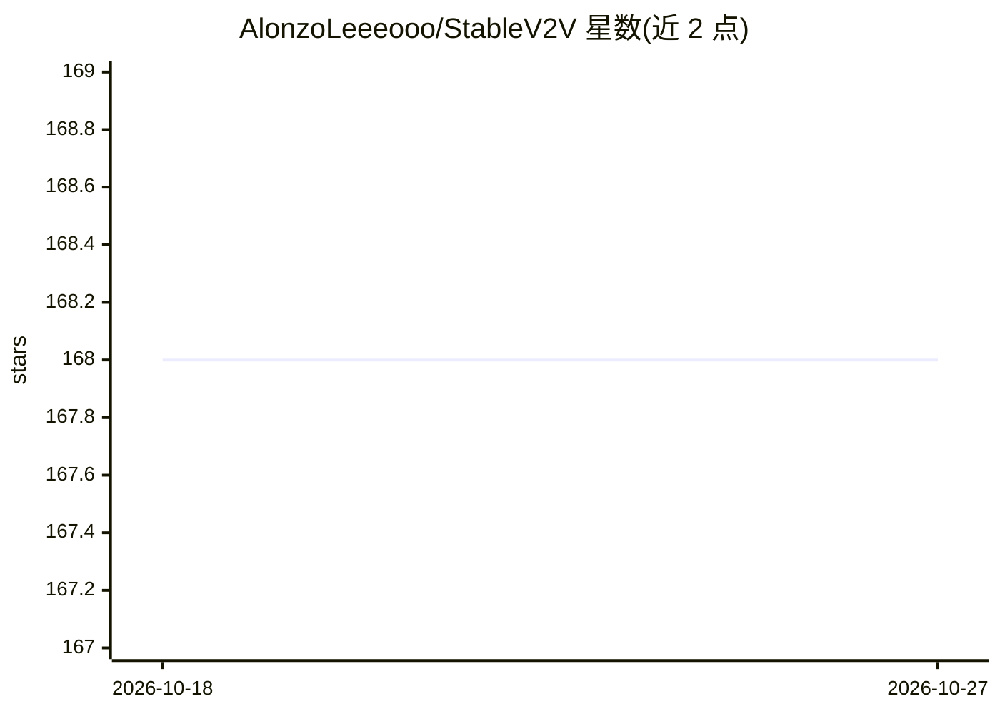

# AlonzoLeeeooo/StableV2V

⭐ 168 · Python · MIT · 推送 2025-12-11 · [GitHub](https://github.com/AlonzoLeeeooo/StableV2V) · [官网](https://alonzoleeeooo.github.io/StableV2V/) · 组织维护 · 中文 README

**论文官方实现：形状一致的视频到视频编辑方法**

TCSVT 2025 论文 StableV2V 的官方代码实现，作者来自高校团队（Chang Liu 等）。方法以形状一致的方式执行视频编辑，处理用户提示引起显著形状变化的场景；流程分三阶段：图像编辑器编辑首帧（PFE，支持 Paint-by-Example/InstructPix2Pix/AnyDoor 等）、源视频分析（ISA，用 RAFT/MiDaS/U2-Net）、条件视频生成（CIG，基于 SD v1.5/ControlNet/I2VGen-XL）。以 Python 源码仓库形式提供，需 conda 环境并下载多个预训练权重；另发布 DAVIS-Edit 测试基准与 Gradio demo。当前不支持 xformers。

## 筛选速览

| 维度 | 判定 | 备注 |
|---|---|---|
| AI 角色 | `ai-native` | 本体是模型或模型工具 |
| 许可风险 | `permissive` | MIT |
| 部署形态 | `library` | 以包/库形式分发 |
| 模型依赖 | — | README 未给出锁定关系 |
| 硬件要求 | — | 无带数字的原话,不猜 |
| 安装摩擦 | `low` | 无编译、无系统依赖或容器化 |
| 成熟度 | — | 结构信号不足 |

## 能力要点

- 三阶段管线：PFE 首帧编辑 + ISA 源视频分析 + CIG 条件视频生成
- 支持 5 种图像编辑器后端（Paint-by-Example/InstructPix2Pix/SD Inpaint/ControlNet/AnyDoor）
- 支持草图引导编辑与视频修复等下游场景
- 发布 DAVIS-Edit 测试基准与 Gradio 交互 demo

## 适用场景

- 研究者复现论文的形状一致视频编辑方法
- 用文本提示或参考图像对视频内容做大幅形状变化的编辑
- 在手绘草图基础上生成编辑后的视频

## 场景标签

`视频生成` · 领域:内容生成

## 证据(README 行号)

> L1: # StableV2V: Stablizing Shape Consistency in Video-to-Video Editing
> L12: `StableV2V` presents a novel paradigm to perform video editing in a shape-consistent manner, especially handling th
> L21: - [Dec. 11th, 2025] Our paper is accepted at TCSVT 2025!

## 星数曲线

2026-10-18 168 → 2026-10-27 168（+0）

---
*卡片 v1 · prompt 1.4 · 生成 2026-10-22 · 置信度 mid · 依据 README sha `73b4e250447b` · [字段定义](../../DATASET.md)*
