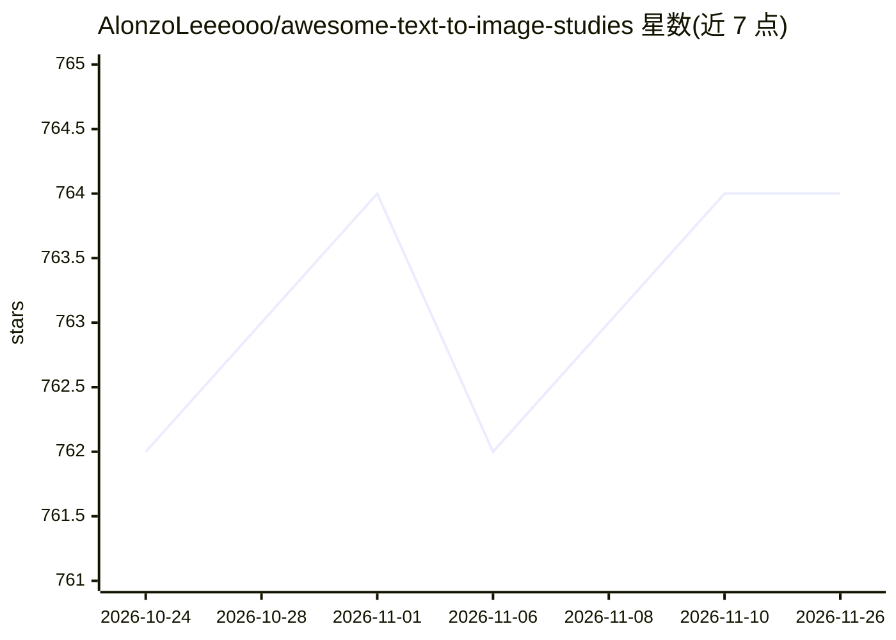

# AlonzoLeeeooo/awesome-text-to-image-studies

⭐ 764 · TeX · MIT · 推送 2026-11-20 · [GitHub](https://github.com/AlonzoLeeeooo/awesome-text-to-image-studies) · 个人维护

**为研究者汇总文生图论文与资源的清单仓库**

按研究方向、发表年份与会议组织文生图（T2I）生成相关论文与资源的清单仓库，含综述、条件生成、图像编辑等专题，提供论文链接、BibTeX 引用及配套代码链接；topics 部分收录 Diffusion Transformer、LLM 结合扩散模型等专题，另附在线生成产品与工具包网站汇总表，并持续更新 CVPR/ICLR/NeurIPS 等会议论文收录情况与待办清单。

## 筛选速览

| 维度 | 判定 | 备注 |
|---|---|---|
| AI 角色 | `ai-knowledge` | 知识聚合/清单类 |
| 许可风险 | `permissive` | MIT |
| 部署形态 | `None` |  |
| 模型依赖 | — | README 未给出锁定关系 |
| 硬件要求 | — | 无带数字的原话,不猜 |
| 安装摩擦 | `low` | 无编译、无系统依赖或容器化 |
| 成熟度 | — | 结构信号不足 |

## 能力要点

- 按研究方向、年份与会议组织的 T2I 论文清单
- 附 reference.bib 提供各论文的 BibTeX 引用
- Products 部分汇总在线文生图产品与工具包
- 按季度更新各会议论文列表与待办事项

## 适用场景

- 查找文生图方向的会议论文与引用
- 调研扩散模型相关研究专题脉络
- 了解现有在线文生图产品与工具包

## 场景标签

`精选清单` `图像生成` · 领域:内容生成

## 证据(README 行号)

> L3: This GitHub repository summarizes papers and resources related to the text-to-image (T2I) generation task.
> L6: > This document serves as the `homepage` of the whole GitHub repo. Papers are summarized according to **different re
> L74: - **Text-to-Image Generation**

## 星数曲线

2026-10-24 762 → 2026-11-26 764（+2）

---
*卡片 v1 · prompt 1.4 · 生成 2026-11-24 · 置信度 high · 依据 README sha `62839724f9ed` · [字段定义](../../DATASET.md)*
