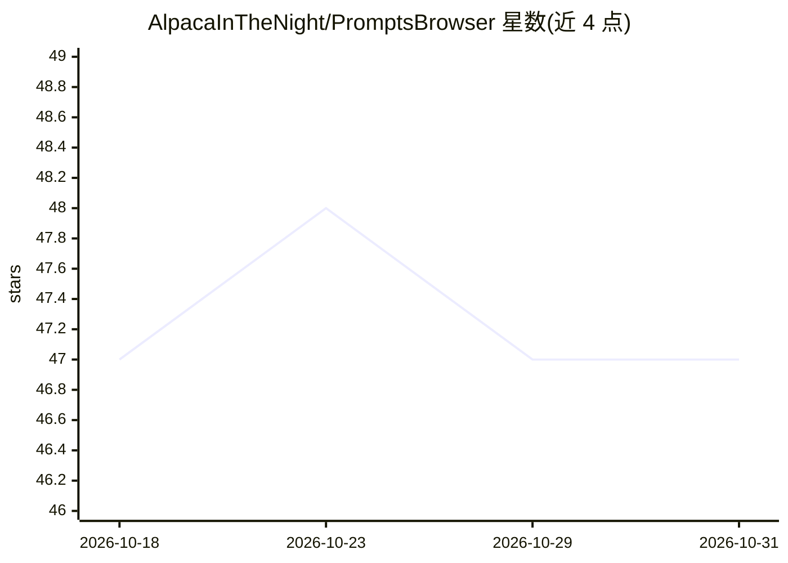

# AlpacaInTheNight/PromptsBrowser

⭐ 47 · JavaScript · AGPL-3.0 · 推送 2026-05-24 · [GitHub](https://github.com/AlpacaInTheNight/PromptsBrowser) · 个人维护

**stable-diffusion-webui 的提示词浏览器扩展：管理/复用提示词与样式**

面向 AUTOMATIC1111/stable-diffusion-webui 用户的浏览器扩展：将提示词按集合/类别/标签组织，支持添加、拖拽排序、调整权重、分组（可嵌套）、相似提示词推荐，以及将当前提示词与生成参数保存为样式复用。可为提示词生成预览图（含按模型分别存储），集合以目录形式存在、可在安装间迁移共享。1.4.0 版本以 React 重写客户端，并支持 Forge 分支的 WebUI。直接修改 DOM 实现，WebUI 更新可能造成兼容性中断。

## 筛选速览

| 维度 | 判定 | 备注 |
|---|---|---|
| AI 角色 | `ai-ecosystem` | LLM/agent 周边工具 |
| 许可风险 | `viral` | AGPL-3.0 |
| 部署形态 | `library` | 以包/库形式分发 |
| 模型依赖 | — | README 未给出锁定关系 |
| 硬件要求 | — | 无带数字的原话,不猜 |
| 安装摩擦 | `low` | 无编译、无系统依赖或容器化 |
| 成熟度 | — | 结构信号不足 |

## 能力要点

- 提示词集合管理：类别/标签过滤、自动补全、拖拽排序与权重调整
- 提示词分组语法支持，分组可嵌套并可整体操作
- 样式保存（含生成参数）与三种添加模式（All/Unique at root/Unique all）
- 提示词预览图生成，可按模型分别存储预览

## 适用场景

- 在 WebUI 中浏览和复用积累的提示词集合
- 把常用提示词组合保存为样式一键套用
- 为提示词生成和管理预览图以便挑选

## 场景标签

`提示工程` · 领域:Agent 开发

## 证据(README 行号)

> L2: Prompts Browser Extension for the AUTOMATIC1111/stable-diffusion-webui.
> L19: - Forge support. Implemented compatibility with Forge, a popular fork of the Automatic1111 WebUI, including proper 

## 星数曲线

2026-10-18 47 → 2026-10-31 47（+0）

---
*卡片 v1 · prompt 1.4 · 生成 2026-10-25 · 置信度 mid · 依据 README sha `089abfae1120` · [字段定义](../../DATASET.md)*
