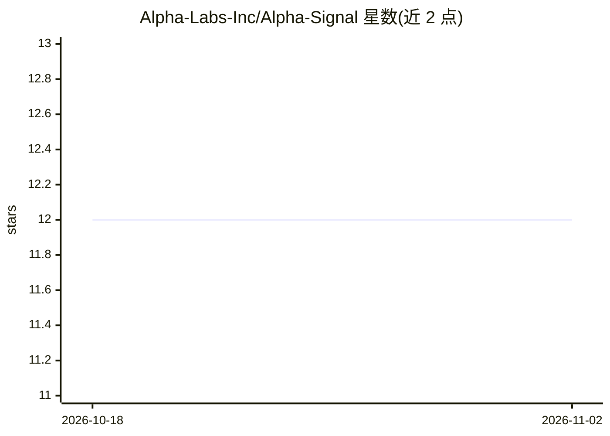

# Alpha-Labs-Inc/Alpha-Signal

⭐ 12 · Python · MIT · 推送 2025-12-07 · [GitHub](https://github.com/Alpha-Labs-Inc/Alpha-Signal) · 组织维护

**面向 Solana 交易者的 AI 实时加密信号与自动交易框架**

Alpha Signal Crypto 是自托管的加密货币交易框架：通过 TweetCatcher webhook 接收 X/Twitter 推文，经可配置的 LLM 提供商（OpenAI/Anthropic/Google/Deepseek/Mistral）生成实时交易信号，接入 Jupiter 与 Dex Screener 执行交易并支持自动卖出；后端为 Python/Poetry，前端为 React，数据库为本地 SQLite，用 ngrok 转发 webhook。运行需配置多个环境变量（API key、ngrok token、Solana 钱包密钥对），X webhook 转发依赖付费第三方服务。README 含代币合约地址。

## 筛选速览

| 维度 | 判定 | 备注 |
|---|---|---|
| AI 角色 | `ai-native` | 本体是模型或模型工具 |
| 许可风险 | `permissive` | MIT |
| 部署形态 | `self-host` | docker 或自建部署 |
| 模型依赖 | locked-api |  |
| 硬件要求 | — | 无带数字的原话,不猜 |
| 安装摩擦 | `low` | 无编译、无系统依赖或容器化 |
| 成熟度 | `idea` | |

## 能力要点

- TweetCatcher webhook 接收推文并加入信号列表
- LLM_PROVIDER 可选 openai/anthropic/google/deepseek/mistral
- Jupiter、Dex Screener、X/Twitter 集成与自动卖出功能
- 提供 setup.sh/start.sh/stop.sh 脚本经 Docker Desktop 管理服务

## 适用场景

- 自托管一套接收推特消息的 Solana 交易信号系统
- 配置自动卖出与提现（send_sol_home.py）管理钱包 SOL
- 用自己选择的 LLM 提供商驱动信号分析

## 场景标签

`金融量化` · 领域:学习与行业

## 证据(README 行号)

> L92: |AI Providers|OpenAI Anthropic Deepseek Google HuggingFace Mistral|
> L105: - `LLM_PROVIDER`: one of `openai`, `anthropic`, `google`, `deepseek`, `mistral`
> L134: 3. When a tracked account tweets, TweetCatcher will POST to your app, and the tweet is added to Alpha Signal's sig

## 星数曲线

2026-10-18 12 → 2026-11-02 12（+0）

---
*卡片 v1 · prompt 1.4 · 生成 2026-11-01 · 置信度 mid · 依据 README sha `ccc52e69d2dd` · [字段定义](../../DATASET.md)*
