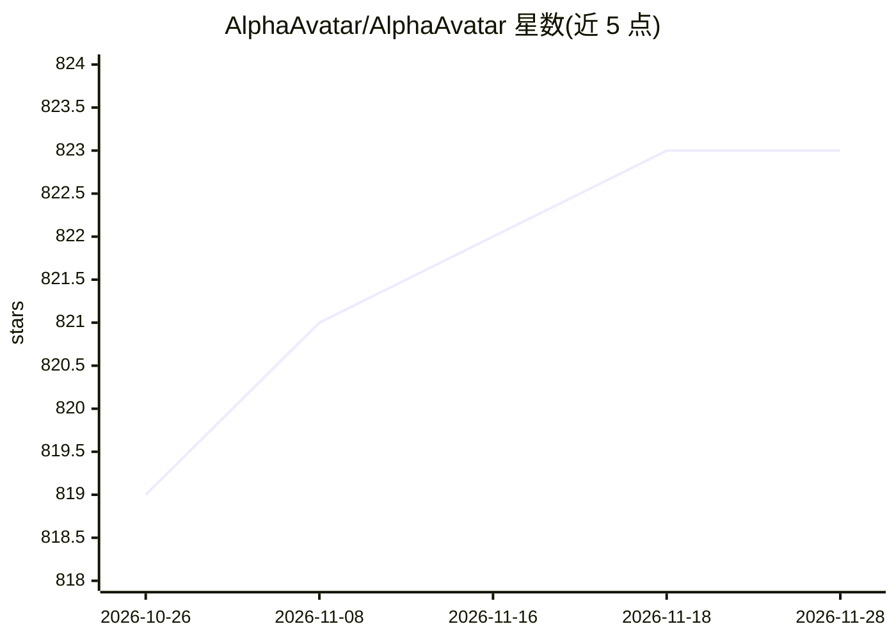

# AlphaAvatar/AlphaAvatar

⭐ 823 · Python · Apache-2.0 · 推送 2026-11-27 · [GitHub](https://github.com/AlphaAvatar/AlphaAvatar) · [官网](https://www.alphaavatar.ai) · 组织维护

**可自托管的实时多模态个人 AI 助理框架**

AlphaAvatar 是一个可自托管的个人助理框架，围绕插件化实时 Agent 架构组织，包含 Memory、Persona、Reflection/Planning/Behavior（规划中）、Tools（MCP/RAG/DeepResearch）与虚拟角色等模块。运行时为分层多模态架构：实时文本/语音/摄像头/屏幕输入，经感知、Router、Loop 执行后输出语音与字幕；RTC 传输当前使用 LiveKit 适配器，其他后端未实现。提供 Linux 安装包（自带 Python）与交互式 Setup，使用 Python 3.13 工具链。

## 筛选速览

| 维度 | 判定 | 备注 |
|---|---|---|
| AI 角色 | `ai-native` | 本体是模型或模型工具 |
| 许可风险 | `permissive` | Apache-2.0 |
| 部署形态 | `None` |  |
| 模型依赖 | — | README 未给出锁定关系 |
| 硬件要求 | — | 无带数字的原话,不猜 |
| 安装摩擦 | `low` | 无编译、无系统依赖或容器化 |
| 成熟度 | — | 结构信号不足 |

## 能力要点

- 插件化实时 Agent 架构：Memory/Persona/RAG/MCP/DeepResearch 等插件
- 实时多模态输入：文本、语音、摄像头与屏幕观察
- 全双工打断与 utterance 级 turn taking
- 可自托管，数据与运行时配置由用户掌控

## 适用场景

- 自托管一个能记住长期上下文的个人助理
- 管理个人笔记、知识库并通过 RAG 检索
- 任务拆解、提醒与多步骤工作流规划
- 通过语音与虚拟角色进行实时交互

## 场景标签

`AI 助手` `语音 Agent` `知识库管理` `RAG` · 领域:对话与助手

## 证据(README 行号)

> L35: AlphaAvatar is a **self-hostable Omni Personal Assistant framework** designed to evolve into an **intelligent perso
> L37: It is built around a **plugin-based real-time Agent architecture**, combining:
> L47: ✨ **Self-hostable and privacy-first** — AlphaAvatar can run on your own infrastructure, giving you control over run

## 星数曲线

2026-10-26 819 → 2026-11-28 823（+4）

---
*卡片 v1 · prompt 1.4 · 生成 2026-11-26 · 置信度 mid · 依据 README sha `c68926ffec5c` · [字段定义](../../DATASET.md)*
