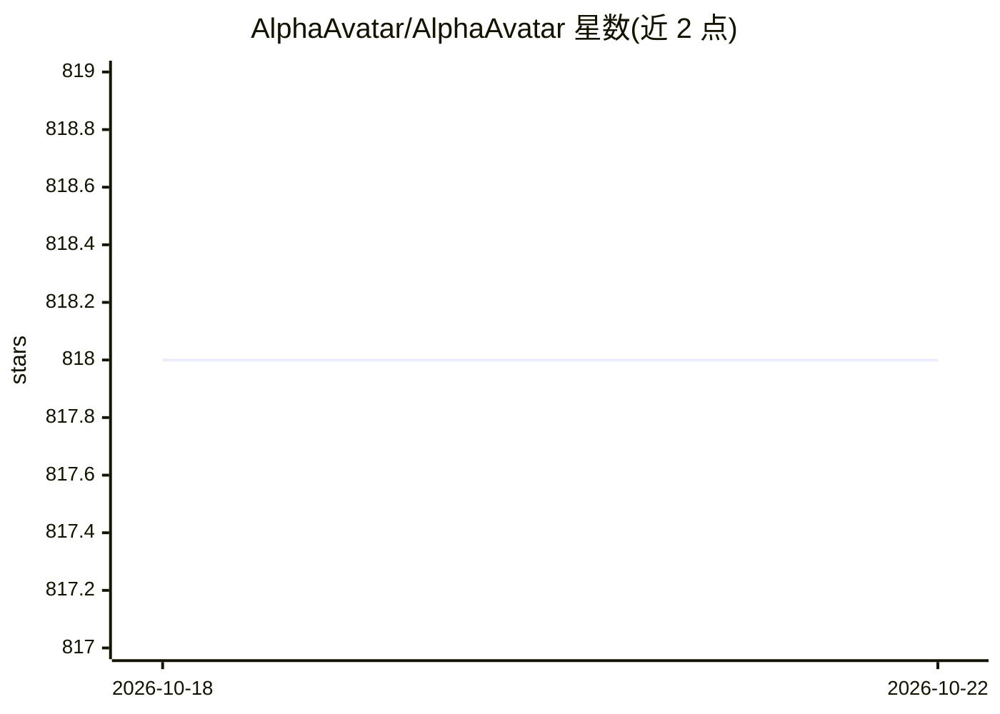

# AlphaAvatar/AlphaAvatar

⭐ 818 · Python · Apache-2.0 · 推送 2026-10-20 · [GitHub](https://github.com/AlphaAvatar/AlphaAvatar) · [官网](https://www.alphaavatar.ai) · 组织维护

**自托管全模态实时个人 AI 助手框架，面向所有人**

AlphaAvatar 是一个可自托管的 Omni 个人助手框架，围绕插件化实时 Agent 架构构建，组合记忆、人格画像、反思、规划、行为策略、工具调用与虚拟形象等能力。运行时采用分层实时多模态架构：LiveKit 等 RTC 适配层、核心感知、Agent 运行时、插件生态、模型提供层与存储层。插件分基础层（Voice）、感知层（Router/Memory/Persona/Character/Status）与工具层（MCP/DeepResearch/RAG），部分插件（Reflection/Planning/Sandbox 等）标记为 Planned。支持本地或自有基础设施部署，强调数据与记忆自控，通过 PyPI 安装。

## 筛选速览

| 维度 | 判定 | 备注 |
|---|---|---|
| AI 角色 | `ai-native` | 本体是模型或模型工具 |
| 许可风险 | `permissive` | Apache-2.0 |
| 部署形态 | `library` | 以包/库形式分发 |
| 模型依赖 | — | README 未给出锁定关系 |
| 硬件要求 | — | 无带数字的原话,不猜 |
| 安装摩擦 | `low` | 无编译、无系统依赖或容器化 |
| 成熟度 | — | 结构信号不足 |

## 能力要点

- 插件化实时 Agent 架构：记忆/人格/反思/规划/行为/工具/虚拟形象分层组织
- 分层实时多模态运行时，覆盖语音、文本、摄像头、屏幕、消息平台等输入通道
- MCP 工具发现与调用、DeepResearch 多步研究、RAG 文档检索插件
- 完全自托管、隐私优先，可本地运行

## 适用场景

- 搭建长期记忆、持续个性化的私人 AI 管家
- 通过语音/文本/摄像头等多模态通道与虚拟形象实时交互
- 管理个人数据、知识笔记、任务提醒并自主规划执行

## 场景标签

`AI 助手` `语音 Agent` `Agent 记忆` `多模态` · 领域:Agent 开发

## 证据(README 行号)

> L35: AlphaAvatar is a **self-hostable Omni Personal Assistant framework** designed to evolve into an **intelligent perso
> L103: > It is a foundation for building **stateful, proactive, multimodal, and self-evolving personal AI assistants**.

## 星数曲线

2026-10-18 818 → 2026-10-22 818（+0）

---
*卡片 v1 · prompt 1.4 · 生成 2026-10-21 · 置信度 high · 依据 README sha `f2bcf36e7ac9` · [字段定义](../../DATASET.md)*
