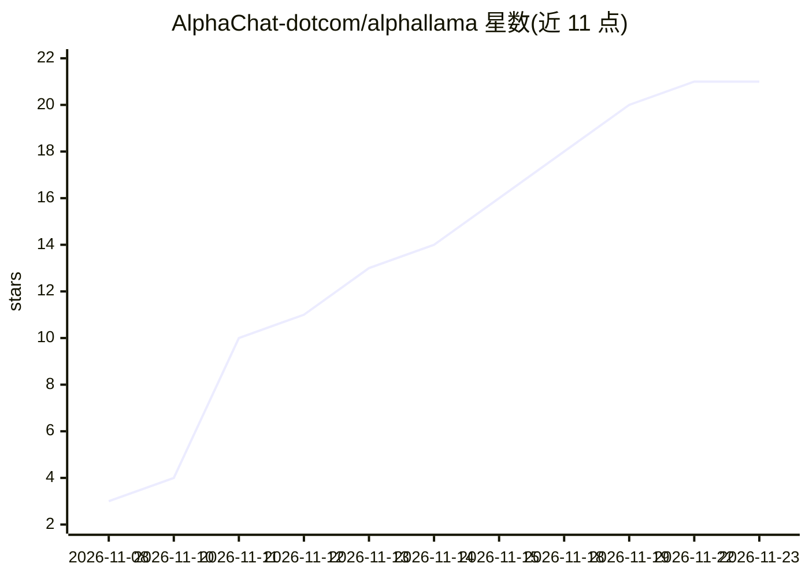

# AlphaChat-dotcom/alphallama

⭐ 21 · C++ · Apache-2.0 · 推送 2026-11-21 · [GitHub](https://github.com/AlphaChat-dotcom/alphallama) · [官网](https://alphachat.com) · 组织维护

**在消费级 GPU 上运行超出显存的大 MoE 模型的 llama.cpp 分支**

AlphaLlama 是 llama.cpp 的分支，保留 GGUF 格式、工具与 C API，新增：MoE 专家卸载（热专家驻留 GPU，其余从内存/磁盘流式加载或 CPU 并行计算）、多 token 预测解码、自动选配置的 OpenAI 兼容服务器 alphallama-serve、本地语料 BM25 检索，以及第二套 CUDA 引擎 AlphaInfer。面向在有限显存（如 16-32 GB）上本地运行大型 MoE 模型的开发者；提供 Linux/Windows/macOS 预编译包，也可用 CMake 从源码构建。

## 筛选速览

| 维度 | 判定 | 备注 |
|---|---|---|
| AI 角色 | `ai-ecosystem` | LLM/agent 周边工具 |
| 许可风险 | `permissive` | Apache-2.0 |
| 部署形态 | `None` |  |
| 模型依赖 | — | README 未给出锁定关系 |
| 硬件要求 | `cpu-ok` | |
| 安装摩擦 | `high` | 编译与系统依赖俱全 |
| 成熟度 | `idea` | |

## 能力要点

- MoE 专家卸载：VRAM+内存+磁盘作为统一专家存储，运行数倍于显存的模型
- alphallama-serve 自动测量机器并选取适配 GPU 类别的配置，OpenAI 兼容 API
- MTP 解码在已验证模型上与普通解码输出一致
- 内置 BM25 关键词索引与可选 dense 重排序的本地语料检索

## 适用场景

- 在 16-32 GB 显存显卡上本地运行大参数 MoE 模型
- 通过 OpenAI 兼容 API 在本机提供 LLM 推理服务
- llama.cpp 用户迁移：保留 GGUF 格式与既有工具链

## 场景标签

`推理引擎` · 领域:训练与推理

## 证据(README 行号)

> L31: AlphaLlama is a fork of llama.cpp.
> L39: - **`alphallama-serve`**, an OpenAI-compatible HTTP server that picks a configuration for the model and GPU

## 星数曲线

2026-11-08 3 → 2026-11-23 21（+18）

---
*卡片 v1 · prompt 1.4 · 生成 2026-11-18 · 置信度 high · 依据 README sha `a0f489e037e8` · [字段定义](../../DATASET.md)*
