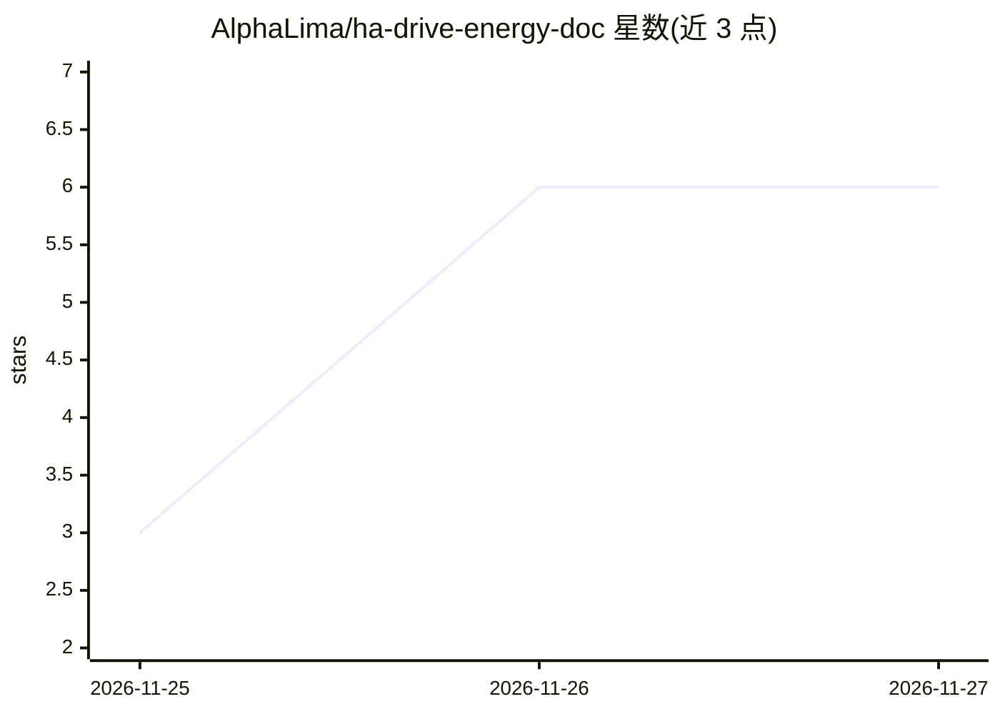

# AlphaLima/ha-drive-energy-doc

⭐ 6 · Python · MIT · 推送 2026-11-26 · [GitHub](https://github.com/AlphaLima/ha-drive-energy-doc) · [官网](https://github.com/AlphaLima/ha-drive-energy-doc) · 个人维护

**Home Assistant 车辆加油/充电全自动记录集成**

面向 Home Assistant 的 HACS 集成，为多辆燃油车与电动车自动维护加油和充电日志：通过车辆的液位、里程、GPS 传感器检测加油事件并用状态机判定完成，自动查询附近加油站价格并计算油耗/电耗；也可无传感器运行，用户经 Telegram/WhatsApp 发送小票或里程表照片，由 AI 读取数量、单价、总价与日期并归档。支持 CSV/PDF 导出、AdBlue 等附加耗材记录与一次性历史数据导入。

## 筛选速览

| 维度 | 判定 | 备注 |
|---|---|---|
| AI 角色 | `ai-enhanced` | 去掉 AI 部分产品仍成立 |
| 许可风险 | `permissive` | MIT |
| 部署形态 | `None` |  |
| 模型依赖 | — | README 未给出锁定关系 |
| 硬件要求 | — | 无带数字的原话,不猜 |
| 安装摩擦 | `low` | 无编译、无系统依赖或容器化 |
| 成熟度 | — | 结构信号不足 |

## 能力要点

- 基于液位传感器的状态机自动检测加油事件（5% 阈值、静止与驶离判定）
- 小票照片经 AI 读取数量/价格/总价，小票数值覆盖传感器估算值
- 支持 5 国加油站价格源（Tankerkönig、E-Control 等），无价格源也可运行
- 每车独立 Telegram 聊天通道的车队管理模式，支持 CSV/PDF 导出

## 适用场景

- 自动记录家用燃油车/电动车的加油充电与真实消耗
- 通过给机器人发小票照片完成车队车辆的费用记录
- 留存小票与里程表照片用于税务、公司车或保修凭证

## 场景标签

`文档解析` · 领域:知识与检索

## 证据(README 行号)

> L15: - **Connected to the car (fully automatic):** Home Assistant detects refuelling or charging on its own from the car
> L16: - **Without any connection to the car (photo mode):** Just send a **photo of the odometer** and a **photo of the pu

## 星数曲线

2026-11-25 3 → 2026-11-27 6（+3）

---
*卡片 v1 · prompt 1.4 · 生成 2026-11-24 · 置信度 high · 依据 README sha `837a395d22e1` · [字段定义](../../DATASET.md)*
