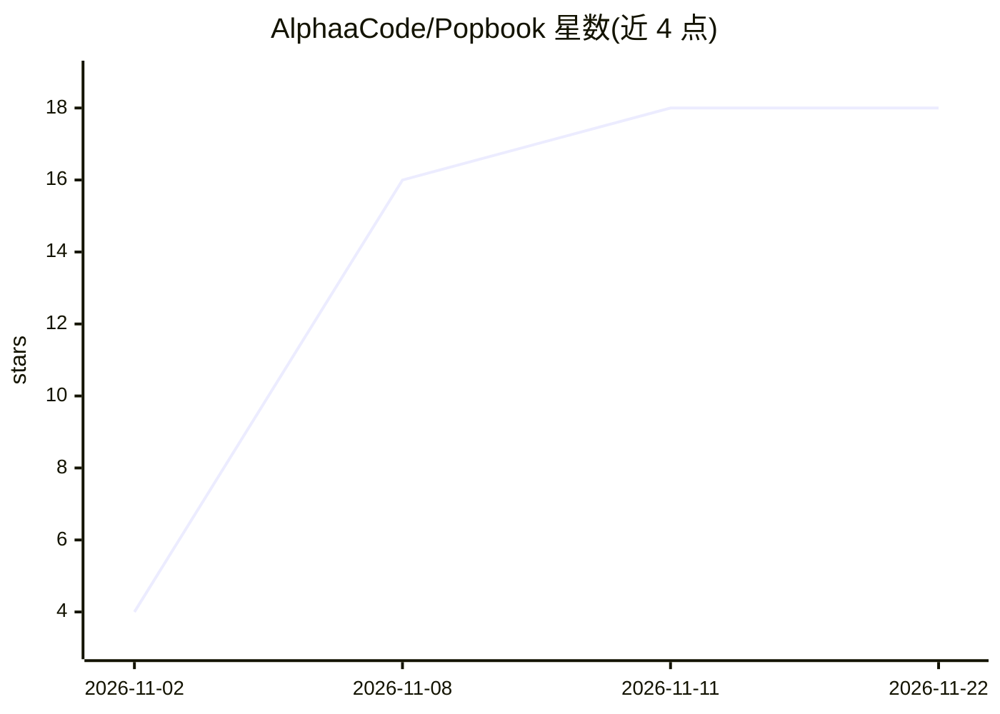

# AlphaaCode/Popbook

⭐ 18 · JavaScript · MIT · 推送 2026-11-13 · [GitHub](https://github.com/AlphaaCode/Popbook) · 个人维护

**把课程 PDF 转成浏览器中交互式 3D 立体教科书的工具**

面向教师与学习者的本地运行 Node.js 应用：上传课程 PDF，连接自有 AI（Claude/OpenAI/Gemini API、OpenAI 兼容端点或 Claude Code 等本地 agent），AI 只生成符合严格格式的 book.json 文件，由手写引擎渲染为 3D 立体书：左页为概念、公式、测验与翻页答案，右页为可交互纸艺 3D 模型（10 种场景块）。验证失败可自动回传重试最多 2 轮；支持导出单 HTML 文件、RTL 语言与手机布局。附带无编程入门指南与两本示例书。

## 筛选速览

| 维度 | 判定 | 备注 |
|---|---|---|
| AI 角色 | `ai-native` | 本体是模型或模型工具 |
| 许可风险 | `permissive` | MIT |
| 部署形态 | `library` | 以包/库形式分发 |
| 模型依赖 | local-ok | 支持本地模型 |
| 硬件要求 | — | 无带数字的原话,不猜 |
| 安装摩擦 | `low` | 无编译、无系统依赖或容器化 |
| 成熟度 | — | 结构信号不足 |

## 能力要点

- AI 仅生成 book.json，由固定引擎渲染，小模型也能得到可靠结果
- 支持 Claude/OpenAI/Gemini API、OpenAI 兼容端点（Ollama/LM Studio 等）及本地 coding agent
- 10 种交互 3D 场景块（race/model/plot/flow 等），验证失败最多 2 轮自动修复
- 可导出为单 HTML 文件，支持 en/fr/ar 界面与 RTL 语言

## 适用场景

- 把讲义或课程 PDF 做成可交互的 3D 立体教材
- 教师用自有 AI（API key 或本地模型）批量生成课件
- 学生通过拖动滑块、点击模型部件理解公式与概念
- 用 Claude Code 等 agent 以命令行方式生成书，无需打开 studio

## 场景标签

 · 领域:教育科技/内容生成工具

## 证据(README 行号)

> L8: Turn any course PDF into an **interactive 3D pop-up textbook** in your browser, using your own AI: an API key, a
> L49: The AI never writes 3D code. It writes one file, `book.json`, in a strict format
> L54: PDF pages ──► model / agent ──► book.json ──► validate (+ up to 2 repair rounds) ──► books/<slug>/ ──► 3D viewer

## 星数曲线

2026-11-02 4 → 2026-11-22 18（+14）

---
*卡片 v1 · prompt 1.4 · 生成 2026-11-18 · 置信度 high · 依据 README sha `f11e97d66738` · [字段定义](../../DATASET.md)*
