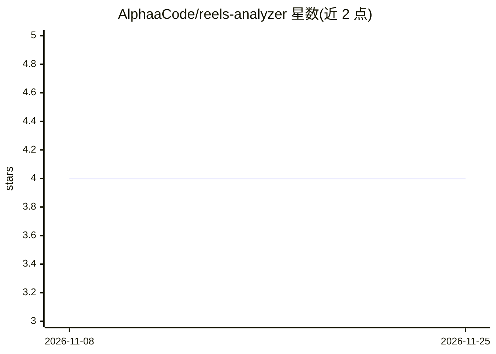

# AlphaaCode/reels-analyzer

⭐ 4 · TypeScript · MIT · 推送 2026-11-06 · [GitHub](https://github.com/AlphaaCode/reels-analyzer) · 个人维护

**本地短视频传播度分析工具：ffmpeg 实测信号加自选 AI 模型评分**

上传短视频后，先用 ffmpeg 在本地测量剪辑节奏、响度、静音、分辨率与前 3 秒钩子画面等信号，再交由用户自选的 AI 模型（OpenAI 兼容端点、Gemini 免费档或无 key 的确定性启发式）生成 JSON 格式传播度报告，带校验器拒绝不合契约的输出。校准引擎用用户真实数据做 Spearman 回测，证据不足时预测保持锁定。提供 Windows 安装包，也可 Node.js 20+ 从源码运行；界面支持英文与阿拉伯语。

## 筛选速览

| 维度 | 判定 | 备注 |
|---|---|---|
| AI 角色 | `ai-native` | 本体是模型或模型工具 |
| 许可风险 | `permissive` | MIT |
| 部署形态 | `desktop` | 安装包/桌面程序 |
| 模型依赖 | local-ok | 支持本地模型 |
| 硬件要求 | — | 无带数字的原话,不猜 |
| 安装摩擦 | `medium` | 含编译或系统依赖之一 |
| 成熟度 | — | 结构信号不足 |

## 能力要点

- ffmpeg 本地测量：切镜、每分钟切镜数、EBU R128 响度、静音、分辨率、钩子窗口帧
- 自带评分校准引擎：Spearman 回测、置换 p 值、Benjamini-Hochberg 校正与 14 天成熟窗口
- 英文/阿拉伯语双语界面与报告字段，阿拉伯语为从右到左排版
- 可选 Edit 标签页：Claude Code CLI 生成剪辑计划，由 ffmpeg 渲染并做前后对比

## 适用场景

- 发布 Instagram Reels 前评估视频的钩子与节奏指标
- 用自己的历史播放数据检验评分是否真的预测触达
- 无 API key 时仅凭本地测量信号获得指标报告
- 依据分析报告生成剪辑计划并重新归一化响度

## 场景标签

`图像视频处理` · 领域:感知与多模态

## 证据(README 行号)

> L5: **An honest, local-first virality check for short-form video.**
> L36: 2. **You bring the model.** Any OpenAI-compatible vision endpoint (NVIDIA NIM, OpenRouter, a local Ollama model), G
> L53: - **Virality score out of 100**, weighted locally from six 1–10 metrics: hook (25%), pacing (20%), visual quality (

## 星数曲线

2026-11-08 4 → 2026-11-25 4（+0）

---
*卡片 v1 · prompt 1.4 · 生成 2026-11-21 · 置信度 high · 依据 README sha `b2dd8faac78a` · [字段定义](../../DATASET.md)*
