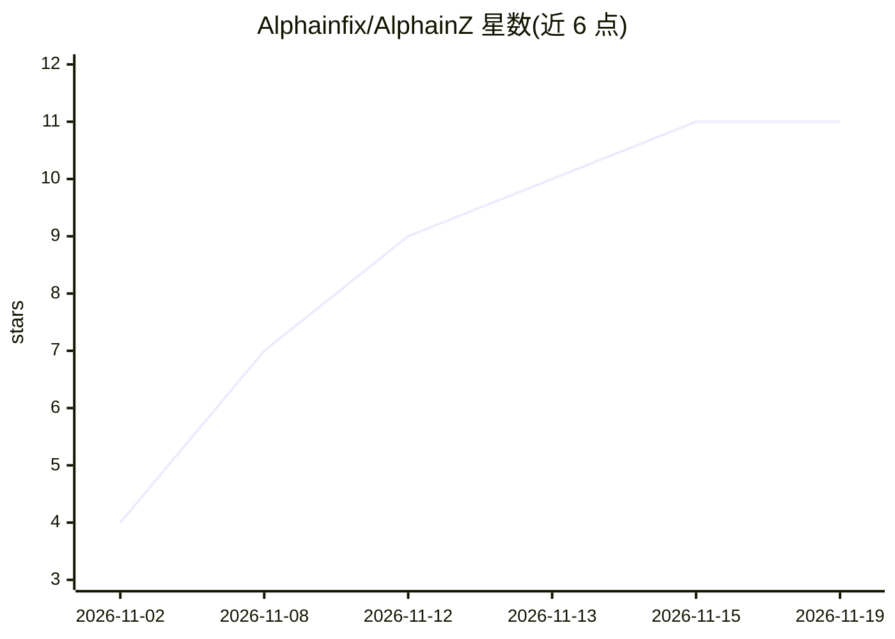

# Alphainfix/AlphainZ

⭐ 11 · TypeScript · AGPL-3.0 · 推送 2026-10-31 · [GitHub](https://github.com/Alphainfix/AlphainZ) · [官网](https://alphain.app/z/) · 个人维护 · 中文 README

**Zotero 内的文献研究助手，用你自己的模型与 API key**

Zotero 7 插件形态的研究助手：将库内 PDF 切分为段落并嵌入，支持云模型（Gemini/OpenAI）或本地 Ollama（EmbeddingGemma 2）嵌入，提供全文语义检索、图片语义检索、句级定位引用并跳转高亮、选中段落问答并把问答写入高亮批注、通过 OpenAlex 检索文献、MCP Server 供其他客户端访问库。模型直连供应商，无中间服务器；自带 6 篇合成论文加 249 篇真实库的检索基准数据。需 Zotero 7+，安装 .xpi 文件。

## 筛选速览

| 维度 | 判定 | 备注 |
|---|---|---|
| AI 角色 | `ai-native` | 本体是模型或模型工具 |
| 许可风险 | `viral` | AGPL-3.0 |
| 部署形态 | `library` | 以包/库形式分发 |
| 模型依赖 | local-ok | 支持本地模型 |
| 硬件要求 | — | 无带数字的原话,不猜 |
| 安装摩擦 | `low` | 无编译、无系统依赖或容器化 |
| 成熟度 | — | 结构信号不足 |

## 能力要点

- 全文与图片的双语义检索，跨语言匹配（英文段落命中中文问题）
- 答案句级定位，点击打开 PDF 并高亮，问答随高亮保存同步
- 内置 DeepSeek/OpenRouter/Zhipu/Gemini/OpenAI/Ollama，兼容 OpenAI API 端点
- MCP Server 以 stdio 服务供 Claude Desktop 等客户端检索文献库

## 适用场景

- 在自己的文献库中做跨语言语义检索
- 阅读时选中段落提问并把答案留在高亮处
- 在 MacBook 上本地嵌入索引而零成本
- 让其他 agent 客户端检索我的 Zotero 库

## 场景标签

`语义搜索` `科研工具` `文档问答` · 领域:知识与检索

## 证据(README 行号)

> L14: **Free and open source. Customize it your way.** AlphainZ is a research assistant inside Zotero. You chat
> L110: Built in: DeepSeek, OpenRouter, Zhipu (BigModel), Google Gemini, OpenAI, and Ollama on your own computer.
> L138: 1. Download the `.xpi` file from the latest release.

## 星数曲线

2026-11-02 4 → 2026-11-19 11（+7）

---
*卡片 v1 · prompt 1.4 · 生成 2026-11-19 · 置信度 high · 依据 README sha `4fb8c31c2472` · [字段定义](../../DATASET.md)*
