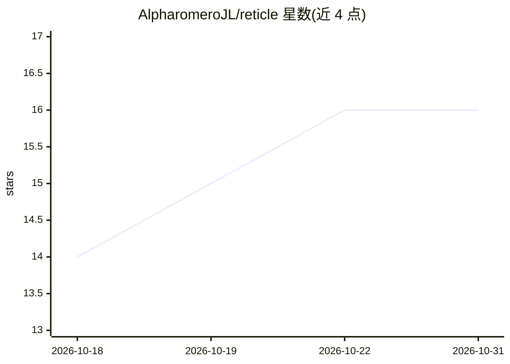

# AlpharomeroJL/reticle

⭐ 16 · Rust · Apache-2.0 · 推送 2026-08-23 · [GitHub](https://github.com/AlpharomeroJL/reticle) · [官网](https://alpharomerojl.github.io/reticle/) · 个人维护

**浏览器原生 GPU 加速的层级化 2D IC 版图编辑器**

用 Rust（原生 + WebAssembly）编写的超大规模层级化 2D 芯片版图编辑器：在浏览器中通过 HTTP Range 流式浏览数 GiB 的 GDSII 等格式版图（首屏仅需约 188 KiB），绘制时实时 DRC 检查，支持三个真实 PDK（SKY130、IHP SG13G2、GF180MCU）上的多边形/路径/单元编辑、六种内置生成器、用户自定义 PCell、版图 diff、SPICE 导出、MCP 服务器（39 个工具）、沙箱化 WASM 插件与桌面离线构建。附带冻结的 95 任务版图 agent 基准与确定性排行榜。给版图设计者、开源硅参与者、教师与研究者使用；限制与未验证项记录于 docs/honest-limits.md。

## 筛选速览

| 维度 | 判定 | 备注 |
|---|---|---|
| AI 角色 | `ai-enhanced` | 去掉 AI 部分产品仍成立 |
| 许可风险 | `permissive` | Apache-2.0 |
| 部署形态 | `None` |  |
| 模型依赖 | local-ok | 支持本地模型 |
| 硬件要求 | — | 无带数字的原话,不猜 |
| 安装摩擦 | `low` | 无编译、无系统依赖或容器化 |
| 成熟度 | — | 结构信号不足 |

## 能力要点

- 流式浏览 3.01 GiB 版图，首视图仅取 188 KiB，无需安装
- 输入时实时 DRC 检查（100k 图形约 5 us），支持三个真实 PDK
- MCP 服务器暴露 39 个工具，含编辑器内 agent 面板（可用本地 Ollama 驱动）
- 冻结可引用的 95 任务版图 agent 基准与双向测试检查器、确定性排行榜

## 适用场景

- 在浏览器里打开并分享真实芯片版图，缩放到晶体管层级
- TinyTapeout 或开源流片参与者在浏览器中查看自己的 tile 并跑官方 precheck
- 模拟/全定制设计者在真实 PDK 上画多边形、跑 DRC、导出 SPICE
- 研究者基于冻结基准与 RL 环境评测版图编辑 agent

## 场景标签

 · 领域:电子设计自动化（EDA）/芯片设计

## 证据(README 行号)

> L6: Reticle is an editor for that world, and it runs entirely in a browser tab: it
> L104: PDKs: SKY130, IHP SG13G2, and GF180MCU. DRC underlines violations as you draw.
> L141: whole pipeline headless. The in-editor agent panel plans, waits for
> L195: against it. This is verification infrastructure: the editor is a normal editor, and

## 星数曲线

2026-10-18 14 → 2026-10-31 16（+2）

---
*卡片 v1 · prompt 1.4 · 生成 2026-10-30 · 置信度 high · 依据 README sha `12ca3e95d48c` · [字段定义](../../DATASET.md)*
