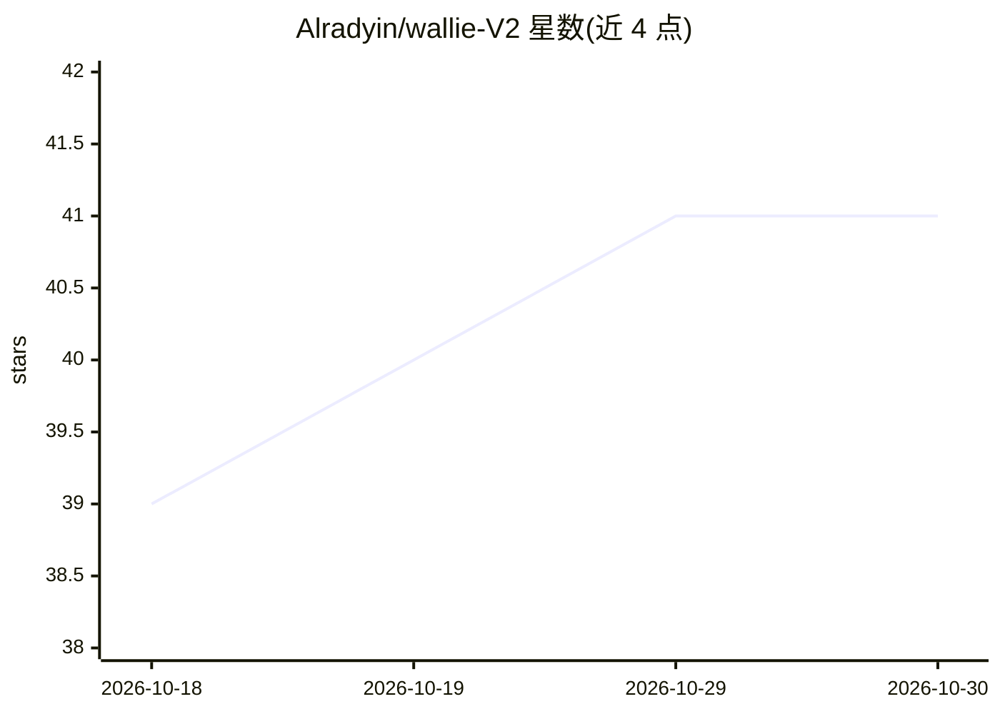

# Alradyin/wallie-V2

⭐ 41 · Python · MIT · 推送 2026-07-07 · [GitHub](https://github.com/Alradyin/wallie-V2) · [官网](https://spontaneous-dodol-cabb7d.netlify.app/) · 个人维护

**开源 AI 虚拟主播：看屏听声、实时反应并可自主玩 Minecraft**

面向无人出镜直播与实时解说的本地运行 AI 主播应用：读取屏幕画面与系统音频（WASAPI 回环，faster-whisper 转写），经注意力/情绪引擎融合为第一人称解说，输出 TTS 语音与 Live2D 头像动画，接入 OBS 虚拟线路推流；支持 Twitch/YouTube/Kick 聊天。提供六种 LLM、三种 TTS 可切换（含 Ollama+Piper 全离线组合），多 persona 系统、滚动摘要与去重引擎维持长时直播记忆。v2.0 Play 模式通过 Fabric 模组与 Baritone 自主游玩 Minecraft 并同步解说。从源码以 Python 脚本运行，使用用户自己的 API key。

## 筛选速览

| 维度 | 判定 | 备注 |
|---|---|---|
| AI 角色 | `ai-native` | 本体是模型或模型工具 |
| 许可风险 | `permissive` | MIT |
| 部署形态 | `library` | 以包/库形式分发 |
| 模型依赖 | local-ok | 支持本地模型 |
| 硬件要求 | — | 无带数字的原话,不猜 |
| 安装摩擦 | `low` | 无编译、无系统依赖或容器化 |
| 成熟度 | — | 结构信号不足 |

## 能力要点

- 视觉+听觉多模态融合的第一人称实时反应，SKIP 机制避免机械播报
- Play 模式自主游玩 Minecraft（Fabric 模组+Baritone 寻路），解说基于真实游戏状态
- 六种 LLM / 三种 TTS / 三种聊天平台可换，支持 Ollama+Piper 全离线
- 滚动摘要、跨会话记忆、去重引擎与话题漂移引擎支持数小时直播
- Live2D 头像带音素口型同步、眨眼与情绪驱动动画

## 适用场景

- 无人出镜的 24 小时 AI 直播间
- 让 AI 以设定人设实时解说我的游戏或屏幕内容
- AI 自主游玩 Minecraft 并边玩边解说
- 全离线（本地模型+本地 TTS）运行虚拟主播

## 场景标签

`多模态` · 领域:感知与多模态

## 证据(README 行号)

> L40:    vision   ──┼──►  Wallie  ──►  Voice (TTS)  ──►  OBS / virtual cable  ──►  your stream
> L88: Six LLM providers. Three TTS engines. Three chat platforms. Mix and match per profile.
> L99: Swap providers without changing code. Run a fully offline stream with Ollama + Piper, or go premium with Claude + E

## 星数曲线

2026-10-18 39 → 2026-10-30 41（+2）

---
*卡片 v1 · prompt 1.4 · 生成 2026-10-25 · 置信度 mid · 依据 README sha `8e7eae5fdd76` · [字段定义](../../DATASET.md)*
