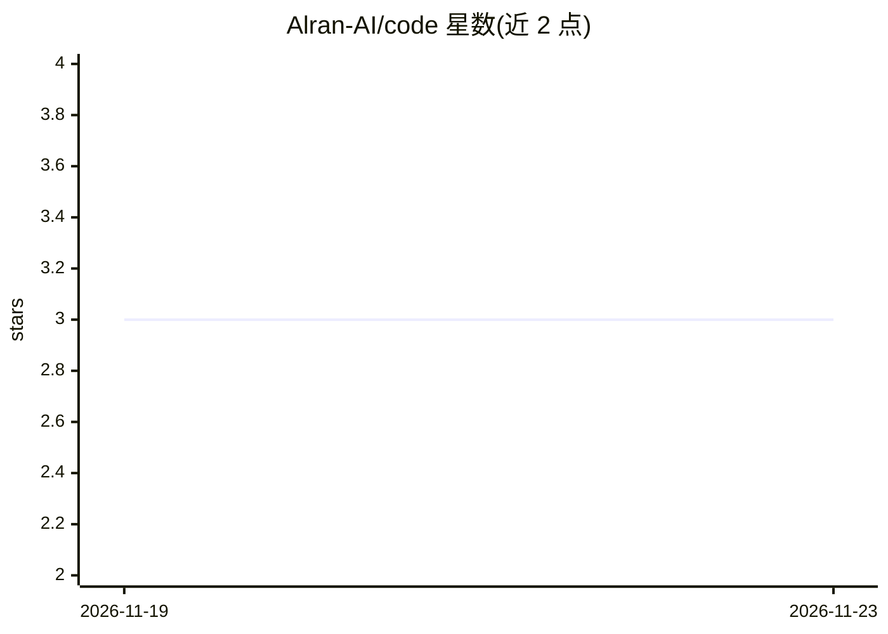

# Alran-AI/code

⭐ 3 · TypeScript · NOASSERTION · 推送 2026-11-22 · [GitHub](https://github.com/Alran-AI/code) · [官网](https://alran.dev) · 组织维护

**终端 AI 编码 agent：读写代码、运行测试并迭代到任务完成**

Alran Code 是面向终端的 AI 编码 agent CLI，读取并编辑代码、运行命令与测试，迭代直至任务通过。默认通过 Ottili AI Gateway 使用 Ottili Werk 模型，可切换 Claude 模型（用自己的 Anthropic API key），并支持添加任意 OpenAI/Anthropic 格式的自定义 provider。入口包括交互式 TUI、headless exec（脚本/CI）、ACP 编辑器集成与 TypeScript SDK；内置插件商店、技能库与多种网页搜索后端，支持 npm 全局安装与源码构建。

## 筛选速览

| 维度 | 判定 | 备注 |
|---|---|---|
| AI 角色 | `ai-native` | 本体是模型或模型工具 |
| 许可风险 | `none` | NOASSERTION |
| 部署形态 | `library` | 以包/库形式分发 |
| 模型依赖 | locked-api |  |
| 硬件要求 | — | 无带数字的原话,不猜 |
| 安装摩擦 | `low` | 无编译、无系统依赖或容器化 |
| 成熟度 | — | 结构信号不足 |

## 能力要点

- 读取/编辑代码、运行命令与测试并持续迭代的终端编码 agent
- 默认 Ottili Werk，支持自带 provider key（openai-completions/openai-responses/anthropic-messages）
- 多种入口：交互式 TUI、headless exec、ACP、TypeScript SDK
- Plugin Store 与 Skill Library 扩展，内置网页搜索（Exa 无密钥默认/Brave/Serper/Tavily/SearXNG）

## 适用场景

- 在终端里让 agent 修复失败测试并跑通相关测试
- 在 CI 或 shell 脚本中用 headless exec 批量执行编码任务
- 通过 ACP 或 SDK 将编码 agent 接入编辑器与 Node.js 代码
- 用 lightweight 模式做不触碰本地文件的轻量问答

## 场景标签

`编码 Agent` · 领域:编码与开发

## 证据(README 行号)

> L9: Alran Code is Ottili's AI coding agent for the terminal. It reads and edits your code, runs
> L10: commands and tests, and keeps iterating until the task works. By default it runs on **Ottili Werk** through the Ott
> L43: alran                   # the interactive terminal UI in the current directory

## 星数曲线

2026-11-19 3 → 2026-11-23 3（+0）

---
*卡片 v1 · prompt 1.4 · 生成 2026-11-22 · 置信度 high · 依据 README sha `04d5c7f91e6b` · [字段定义](../../DATASET.md)*
