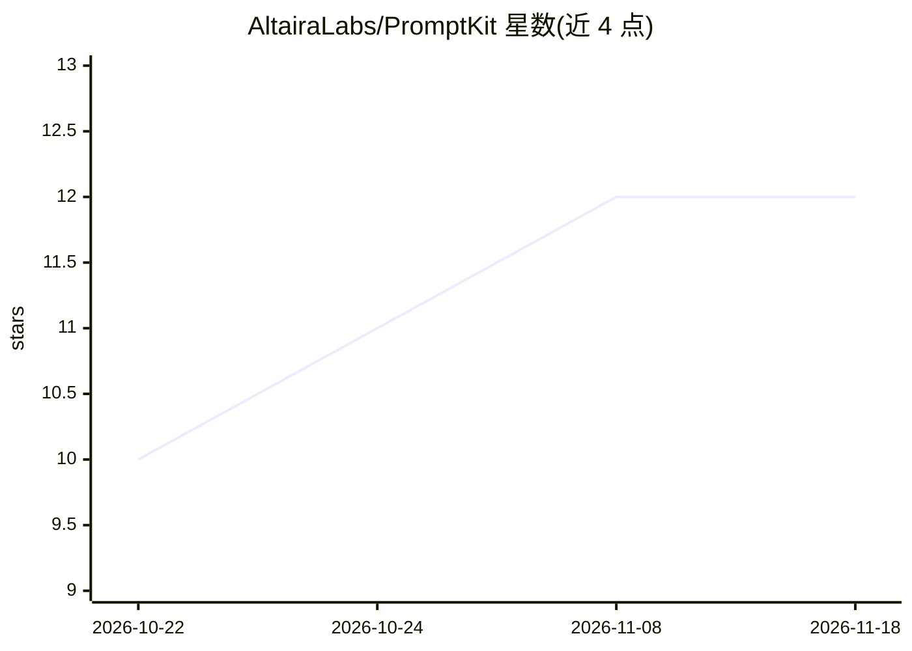

# AltairaLabs/PromptKit

⭐ 12 · Go · Apache-2.0 · 推送 2026-11-17 · [GitHub](https://github.com/AltairaLabs/PromptKit) · [官网](http://promptkit.altairalabs.ai/) · 组织维护

**面向开发者的 Go 语言 LLM 应用运行时与 SDK**

PromptKit 是一个 Go 库，提供多 provider 流式调用、带界压控制的并发栈、原生工具调用（MCP）、A2A 多 agent 编排、事件驱动工作流状态机、语音（STT/TTS 双工）与多模态能力，统一在同一 pipeline 内并内置 Prometheus 指标。提示词与 provider 配置通过 PromptPack 开放规范（JSON）实现可移植。需 Go 1.26+，通过 go get 引入 SDK 嵌入应用；配套 PromptArena CLI 与 PackC 编译器位于独立仓库。附性能基准测试工具与 CI 回归门。

## 筛选速览

| 维度 | 判定 | 备注 |
|---|---|---|
| AI 角色 | `ai-ecosystem` | LLM/agent 周边工具 |
| 许可风险 | `permissive` | Apache-2.0 |
| 部署形态 | `None` |  |
| 模型依赖 | local-ok | 支持本地模型 |
| 硬件要求 | — | 无带数字的原话,不猜 |
| 安装摩擦 | `low` | 无编译、无系统依赖或容器化 |
| 成熟度 | — | 结构信号不足 |

## 能力要点

- 多 provider 统一接口：推理、语音转文本、文本转语音、嵌入、图像
- 三层背压流式控制：首块前重试、per-provider 重试预算、总在途信号量
- MCP 客户端与 A2A 协议服务器（server/a2a）
- PromptPack 规范使提示词/provider 配置可移植、vendor-neutral

## 适用场景

- 在 Go 应用中嵌入多 provider 的 LLM 对话与流式调用
- 构建多 agent 编排与事件驱动工作流
- 开发语音/多模态实时会话应用
- 对 LLM 应用做评测、guardrails 与生产监控

## 场景标签

`Agent 框架` · 领域:Agent 开发

## 证据(README 行号)

> L13: PromptKit is a Go library for building LLM apps that hold up under real load:
> L28:     ├── PromptKit  ── this repo: Go runtime + SDK (embed in your application)

## 星数曲线

2026-10-22 10 → 2026-11-18 12（+2）

---
*卡片 v1 · prompt 1.4 · 生成 2026-11-18 · 置信度 high · 依据 README sha `5bb9547889d0` · [字段定义](../../DATASET.md)*
