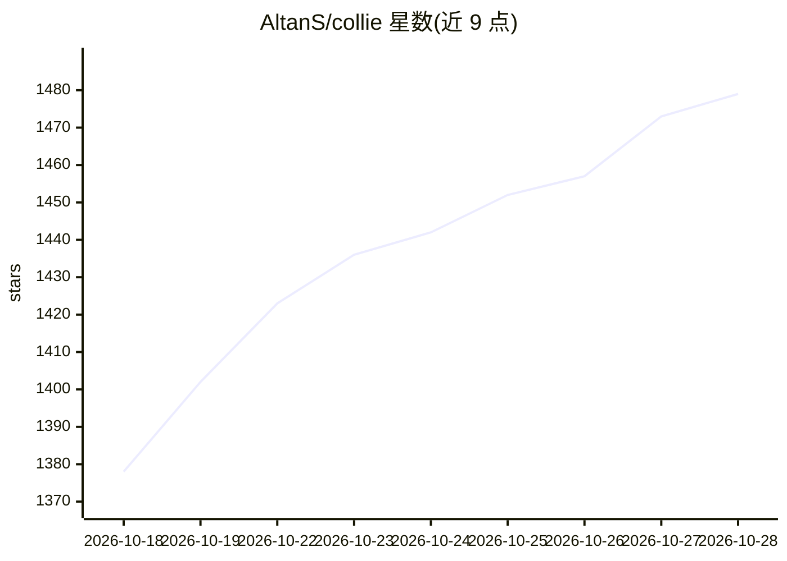

# AltanS/collie

⭐ 1,495 · TypeScript · MIT · 推送 2026-10-28 · [GitHub](https://github.com/AltanS/collie) · [官网](https://colliepwa.dev/) · 个人维护

**从手机驱动终端 AI 编码 agent 的自托管 PWA 客户端**

ColliePWA 是开源（MIT）的自托管移动 Web 应用，用于从 iPhone/Android 远程操作运行在 Herdr（对 tmux/zellij 的支持为实验性）中的终端 AI agent，如 Claude Code、Codex、OpenCode。提供以待输入 agent 为首的状态仪表盘、推送通知、可自定义的特殊按键面板、文件与 git diff 查看（只读）、设备配对、多机 Crews 与跨会话消息。默认经 Tailscale serve 部署，单用户设计，提供 API 即等于远程 shell 访问，明确禁止公网暴露。安装为 curl 脚本，不上架应用商店。

## 筛选速览

| 维度 | 判定 | 备注 |
|---|---|---|
| AI 角色 | `ai-ecosystem` | LLM/agent 周边工具 |
| 许可风险 | `permissive` | MIT |
| 部署形态 | `None` |  |
| 模型依赖 | — | README 未给出锁定关系 |
| 硬件要求 | — | 无带数字的原话,不猜 |
| 安装摩擦 | `low` | 无编译、无系统依赖或容器化 |
| 成熟度 | `idea` | |

## 能力要点

- 状态仪表盘优先展示需要输入的 agent，并推送通知
- 可自定义特殊按键面板（Esc/Ctrl+C/方向键/组合键与预设）
- 文件屏展示工作区文件、git diff 与最近提交（只读）
- 设备配对、Crews 多机单 URL 与跨会话消息（walky talky）

## 适用场景

- 在外出时从手机查看并回复 Claude Code 等终端 agent 的提问
- 从手机启动新 agent 会话、worktree 或自定义命令
- 在多台机器上集中监控 agent 并接收阻塞提醒

## 场景标签

 · 领域:开发者工具/AI agent 运维

## 证据(README 行号)

> L11: self-hosted web app (PWA) for driving terminal AI agents such as Claude Code, Codex and OpenCode
> L75: Collie is for developers running AI agents in a terminal multiplexer who want to resume sessions

## 星数曲线

2026-10-18 1,378 → 2026-10-28 1,479（+101）

---
*卡片 v1 · prompt 1.4 · 生成 2026-10-21 · 置信度 high · 依据 README sha `783d4c068a57` · [字段定义](../../DATASET.md)*
