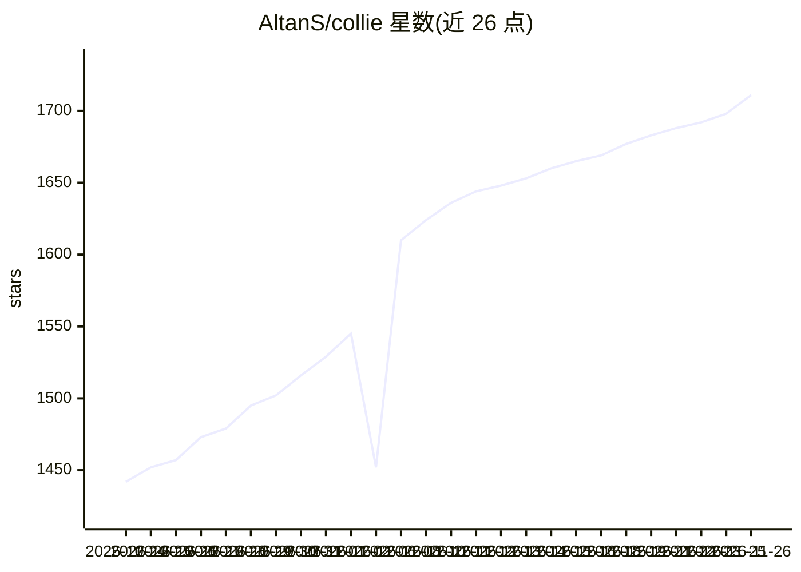

# AltanS/collie

⭐ 1,711 · TypeScript · MIT · 推送 2026-11-25 · [GitHub](https://github.com/AltanS/collie) · [官网](https://colliepwa.dev/) · 个人维护

**把终端 AI 编码 agent 投到手机上操控的自托管 PWA**

开源（MIT）Web 应用，安装在自己电脑上并经 Tailscale tailnet 供手机访问，以主屏 PWA 形式使用，不经应用商店。手机端可查看终端中的编码 agent 会话（Claude Code、Codex、OpenCode 等）、用文本或语音回复、收到推送提醒、从手机启动 agent、查看 git diff。主要面向 Herdr 多路复用器；Herdr core、tmux、zellij、tuios、Tern、Rex 支持为实验性。严格单用户设计，无多租户认证。

## 筛选速览

| 维度 | 判定 | 备注 |
|---|---|---|
| AI 角色 | `ai-ecosystem` | LLM/agent 周边工具 |
| 许可风险 | `permissive` | MIT |
| 部署形态 | `None` |  |
| 模型依赖 | — | README 未给出锁定关系 |
| 硬件要求 | — | 无带数字的原话,不猜 |
| 安装摩擦 | `low` | 无编译、无系统依赖或容器化 |
| 成熟度 | — | 结构信号不足 |

## 能力要点

- 手机查看并回复终端 agent：提示变按钮、快捷回复、语音听写与 Whistle 语音转文字
- WalkyTalky 跨程序与机器在 agent 会话间互发消息并带回执
- 推送通知、git diff 只读查看、多 Collie 主机集群（Crews）与手动故障切换
- 自托管 PWA 经 Tailscale 访问，无账号、不经应用商店

## 适用场景

- 在手机上远程跟进 tmux/Herdr 里运行的编码 agent 会话
- agent 暂停或完成时在手机收到推送并一键批准
- 从手机启动新的 agent 会话并选择目录与 worktree

## 场景标签

`编码 Agent` · 领域:编码与开发

## 证据(README 行号)

> L9: ColliePWA is an open-source (MIT) web app for your phone. It displays your terminal AI agents,
> L107: Collie is for developers running terminal-multiplexed AI agents who want phone access via a touch
> L113: The setup assumes a **Tailscale tailnet**, with `tailscale serve` as the

## 星数曲线

2026-10-24 1,442 → 2026-11-26 1,711（+269）

---
*卡片 v1 · prompt 1.4 · 生成 2026-11-26 · 置信度 high · 依据 README sha `bb55d48bc930` · [字段定义](../../DATASET.md)*
