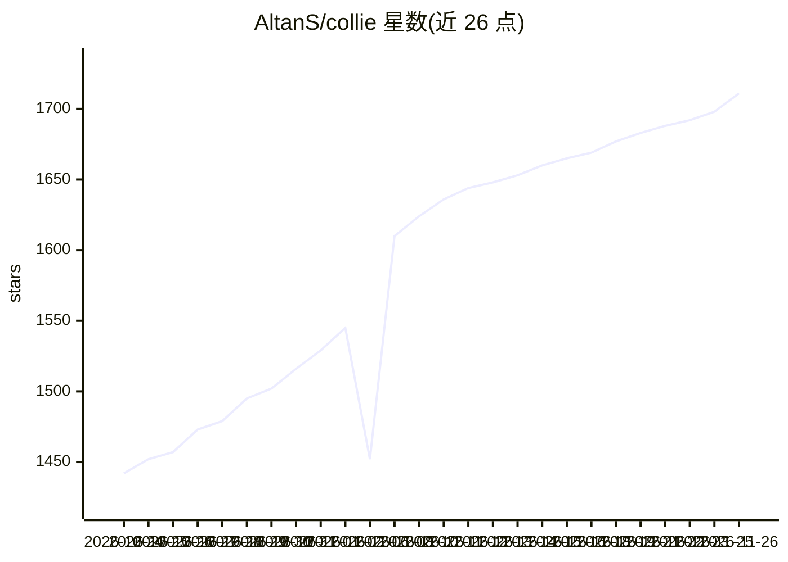

# AltanS/collie

⭐ 1,711 · TypeScript · MIT · 推送 2026-11-25 · [GitHub](https://github.com/AltanS/collie) · [官网](https://colliepwa.dev/) · 个人维护

**在手机上查看并回复终端 AI 编码 agent 的自托管 PWA**

ColliePWA 是一个 MIT 开源、自托管的手机端 Web 应用，与 Herdr 或 tmux/zellij 等多路复用器一起运行在用户自己的电脑上，通过 Tailscale tailnet 提供访问。它显示终端中运行的 AI agent（如 Claude Code、Codex、OpenCode），支持远程回复、从手机启动新 agent、推送通知、语音转文字、查看 git diff、跨会话消息（WalkyTalky）、多主机 Crews 等功能。通过浏览器添加到主屏幕安装，不经过应用商店。严格单用户设计，无多租户认证。

## 筛选速览

| 维度 | 判定 | 备注 |
|---|---|---|
| AI 角色 | `ai-ecosystem` | LLM/agent 周边工具 |
| 许可风险 | `permissive` | MIT |
| 部署形态 | `None` |  |
| 模型依赖 | — | README 未给出锁定关系 |
| 硬件要求 | — | 无带数字的原话,不猜 |
| 安装摩擦 | `low` | 无编译、无系统依赖或容器化 |
| 成熟度 | — | 结构信号不足 |

## 能力要点

- 仪表盘优先展示等待输入的 agent，agent 提示转为可点按钮
- WalkyTalky 支持跨程序、跨机器的 agent 会话间消息与回执
- 内置语音引擎 Whistle 与推送通知（agent 暂停/完成时提醒）
- Crews 将多台主机聚合到一个 URL 并支持手动故障转移

## 适用场景

- SSH 断开后在手机上继续管理 tmux/Herdr 里的 Claude Code 会话
- agent 停下等待批准时收到推送并一键回复
- 从手机为某目录或 git worktree 启动新的编码 agent

## 场景标签

`编码 Agent` · 领域:编码与开发

## 证据(README 行号)

> L9: ColliePWA is an open-source (MIT) web app for your phone. It displays your terminal AI agents,
> L107: Collie is for developers running terminal-multiplexed AI agents who want phone access via a touch
> L64: COLLIE_MUX=herdr collie start          # or: herdr-core, tmux, zellij, tuios, tern, rex

## 星数曲线

2026-10-24 1,442 → 2026-11-26 1,711（+269）

---
*卡片 v1 · prompt 1.4 · 生成 2026-11-23 · 置信度 high · 依据 README sha `799b33d20288` · [字段定义](../../DATASET.md)*
