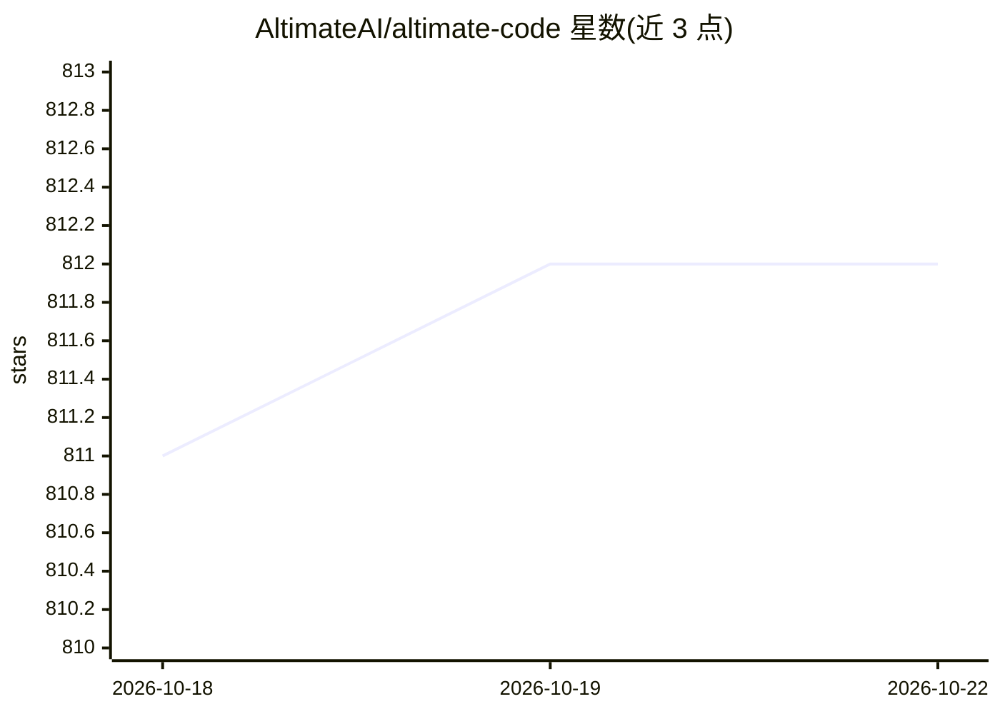

# AltimateAI/altimate-code

⭐ 812 · TypeScript · MIT · 推送 2026-10-21 · [GitHub](https://github.com/AltimateAI/altimate-code) · [官网](https://altimate.sh) · 组织维护

**面向数据团队的开源 agentic 数据工程 harness（SQL/dbt/数仓）**

基于 OpenCode 分叉重构的数据工程工具层：提供 100+ 确定性工具，覆盖 SQL 反模式检测（19 规则）、列级血缘、dbt 集成（manifest 解析、测试生成）、跨方言 SQL 转译、跨 12 数仓数据比对、FinOps 成本分析与 PII 检测。支持 12 种云数仓连接，可在终端独立运行，也可嵌入 Claude Code、Codex 或 CI 流水线。模型无关，自带 Altimate Base 免费默认 LLM 或接入自带 provider。通过 npm 安装或下载自包含二进制；Alpine musl 与 Windows ARM64 暂不支持独立二进制。

## 筛选速览

| 维度 | 判定 | 备注 |
|---|---|---|
| AI 角色 | `ai-ecosystem` | LLM/agent 周边工具 |
| 许可风险 | `permissive` | MIT |
| 部署形态 | `desktop` | 安装包/桌面程序 |
| 模型依赖 | local-ok | 支持本地模型 |
| 硬件要求 | — | 无带数字的原话,不猜 |
| 安装摩擦 | `low` | 无编译、无系统依赖或容器化 |
| 成熟度 | — | 结构信号不足 |

## 能力要点

- 19 条 SQL 反模式规则与列级血缘（确定性解析，非 LLM 模式匹配）
- 跨 12 数仓行级数据比对（5 种算法）与跨方言 SQL 转译
- dbt 原生集成：manifest 解析、单元测试生成、模型脚手架
- FinOps 成本分析与 15 类 PII 检测（30+ 正则）

## 适用场景

- 在终端让 AI agent 安全地开发 dbt 模型与分析 SQL
- 为 Claude Code/Codex 挂载数据工程工具层
- 审计数仓成本、检测 PII 并生成 SQL 审查报告

## 场景标签

`编码 Agent` `数据分析` · 领域:效率与自动化

## 证据(README 行号)

> L5: The intelligence layer for data engineering AI — 100+ deterministic tools for SQL analysis,
> L8: Run standalone in your terminal, embed underneath Claude Code or Codex, or integrate
> L106: **Works seamlessly with Claude Code and Codex.** Use `/configure-claude` or `/configure-codex` to set up integrati

## 星数曲线

2026-10-18 811 → 2026-10-22 812（+1）

---
*卡片 v1 · prompt 1.4 · 生成 2026-10-21 · 置信度 high · 依据 README sha `995aef97eb5c` · [字段定义](../../DATASET.md)*
