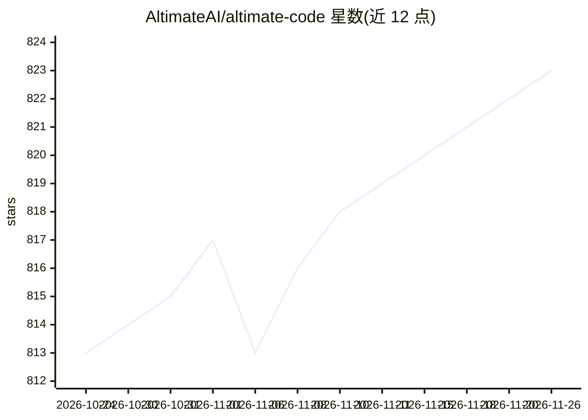

# AltimateAI/altimate-code

⭐ 823 · TypeScript · MIT · 推送 2026-11-25 · [GitHub](https://github.com/AltimateAI/altimate-code) · [官网](https://altimate.sh) · 组织维护

**面向数据团队的 agentic 数据工程 CLI 工具层**

为 dbt、SQL 与云数仓场景提供的开源数据工程 harness：内置 100+ 确定性工具，覆盖 SQL 反模式检测、列级血缘解析、跨方言翻译与校验、FinOps 成本分析、PII 检测、dbt 测试生成与模型脚手架。以 CLI/TUI 运行，可独立使用，也可作为工具层挂载到 Claude Code 或 Codex 之下，或嵌入 CI 与编排 DAG。模型无关，支持多家 LLM 提供商及本地运行；通过 npm 或独立二进制安装。

## 筛选速览

| 维度 | 判定 | 备注 |
|---|---|---|
| AI 角色 | `ai-ecosystem` | LLM/agent 周边工具 |
| 许可风险 | `permissive` | MIT |
| 部署形态 | `desktop` | 安装包/桌面程序 |
| 模型依赖 | local-ok | 支持本地模型 |
| 硬件要求 | — | 无带数字的原话,不猜 |
| 安装摩擦 | `low` | 无编译、无系统依赖或容器化 |
| 成熟度 | — | 结构信号不足 |

## 能力要点

- 100+ 确定性工具：SQL 解析、列级血缘、PII 扫描、FinOps 分析
- 支持 13 类数据仓库的 schema 索引、查询执行与元数据内省
- 提供 Builder/Analyst/Plan 三种权限分级的 Agent 模式
- 19 个内置 skills，可作为 Claude Code/Codex 插件运行

## 适用场景

- 对 dbt 项目做自动化 PR/MR 审查与单元测试生成
- 迁移前跨 Snowflake/BigQuery/Databricks 等方言翻译并校验数据一致性
- 分析数仓成本与闲置资源，审计 PII 列
- 为 AI 编码代理补充数据栈感知的工具层

## 场景标签

`编码 Agent` · 领域:编码与开发

## 证据(README 行号)

> L5: The intelligence layer for data engineering AI — 100+ deterministic tools for SQL analysis,
> L8: Run standalone in your terminal, embed underneath Claude Code or Codex, or integrate
> L122: **Works seamlessly with Claude Code and Codex.** Use `/configure-claude` or `/configure-codex` to set up integrati

## 星数曲线

2026-10-24 813 → 2026-11-26 823（+10）

---
*卡片 v1 · prompt 1.4 · 生成 2026-11-25 · 置信度 high · 依据 README sha `03f792b691ae` · [字段定义](../../DATASET.md)*
