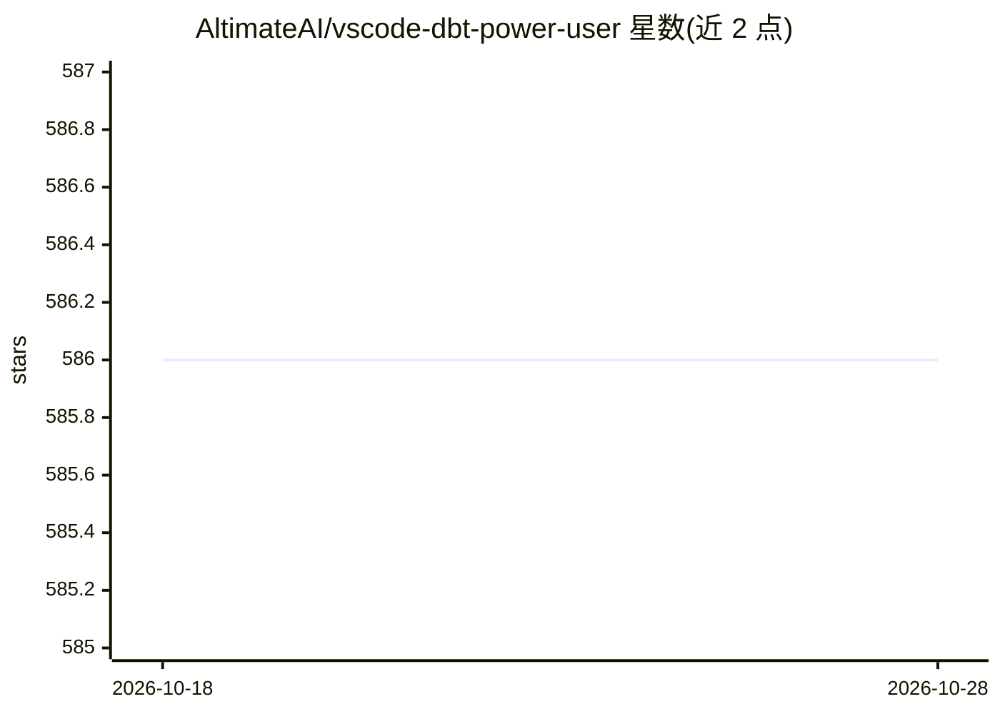

# AltimateAI/vscode-dbt-power-user

⭐ 586 · JavaScript · MIT · 推送 2026-10-27 · [GitHub](https://github.com/AltimateAI/vscode-dbt-power-user) · [官网](https://www.altimate.ai) · 组织维护

**让 VSCode 与 dbt 协同开发的扩展，含 AI 文档生成**

面向使用 dbt 的数据工程师的 VSCode 扩展：提供 dbt 代码自动补全与定义跳转、查询结果预览与分析、模型级与列级血缘、从 source 或 SQL 生成 dbt 模型、自动生成模型与列描述文档（AI docs generation）、生产环境 defer、一键运行父/子模型与测试、编译查询预览与解释、项目健康检查、SQL 校验器与 BigQuery 成本估算。兼容 dev containers、codespaces 与 remote extension，支持 dbt 1.0 以上版本。

## 筛选速览

| 维度 | 判定 | 备注 |
|---|---|---|
| AI 角色 | `ai-enhanced` | 去掉 AI 部分产品仍成立 |
| 许可风险 | `permissive` | MIT |
| 部署形态 | `None` |  |
| 模型依赖 | — | README 未给出锁定关系 |
| 硬件要求 | — | 无带数字的原话,不猜 |
| 安装摩擦 | `low` | 无编译、无系统依赖或容器化 |
| 成熟度 | — | 结构信号不足 |

## 能力要点

- 模型级与列级血缘可视化（models/seeds/sources/exposures）
- 自动生成模型与列描述并保存为 YAML 文档
- 从 source 或既有 SQL 生成 dbt 模型，引用自动填充
- 项目健康检查、SQL 校验与 BigQuery 成本估算

## 适用场景

- 在 VSCode 内编写和运行 dbt 模型与测试
- 查看模型与列级血缘定位数据流
- 自动补全模型名、宏与 source 并跳转定义
- 检查 dbt 项目健康状态并估算 BigQuery 查询成本

## 场景标签

`代码生成` · 领域:编码与开发

## 证据(README 行号)

> L7: This open source extension makes VSCode seamlessly work with dbt™.
> L20: |Generate documentation|Generate model and column descriptions or write in the UI editor. Save formatted text in YA

## 星数曲线

2026-10-18 586 → 2026-10-28 586（+0）

---
*卡片 v1 · prompt 1.4 · 生成 2026-10-21 · 置信度 mid · 依据 README sha `b6726d54e494` · [字段定义](../../DATASET.md)*
