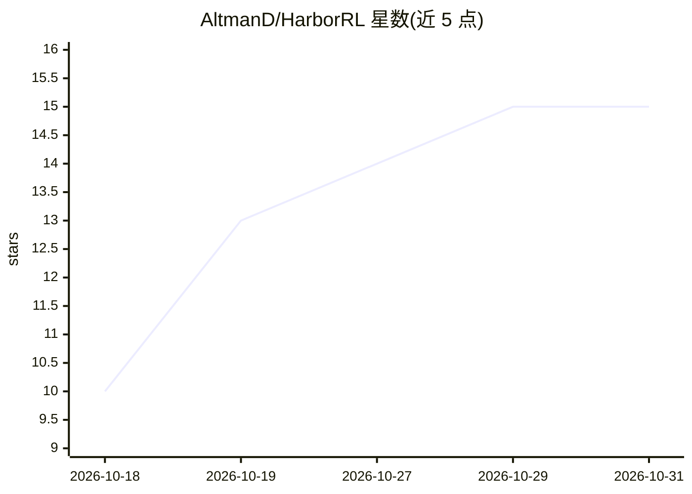

# AltmanD/HarborRL

⭐ 15 · Python · MIT · 推送 2026-10-30 · [GitHub](https://github.com/AltmanD/HarborRL) · 组织维护 · 中文 README

**面向工具调用 agent 的端到端强化学习训练框架**

HarborRL 是训练工具调用 agent 的轻量级强化学习框架，将模型服务、轨迹生成、工具执行、验证器奖励与策略更新整合为单一可复现流水线。支持 Models×Algorithms×Tasks×Harnesses 四维组合：Qwen/GLM 基座、GRPO/DAPO 算法、200+ Harbor 格式沙箱任务（Terminal-Bench、SWE-Bench 等）、40+ harness 框架（Claude Code、LangGraph 等）。提供配置 CLI、本地 Web 控制台与 harborrl doctor 校验；CPU 开发安装无需 CUDA/Docker/模型权重，原生训练经脚本安装后端栈。

## 筛选速览

| 维度 | 判定 | 备注 |
|---|---|---|
| AI 角色 | `ai-ecosystem` | LLM/agent 周边工具 |
| 许可风险 | `permissive` | MIT |
| 部署形态 | `self-host` | docker 或自建部署 |
| 模型依赖 | — | README 未给出锁定关系 |
| 硬件要求 | `cpu-ok` | |
| 安装摩擦 | `low` | 无编译、无系统依赖或容器化 |
| 成熟度 | — | 结构信号不足 |

## 能力要点

- Models×Algorithms×Tasks×Harnesses 四维实验组合（200+ 任务、40+ harness）
- 单一 YAML 配置定义完整实验并锁定任务目录
- 本地 Web 控制台支持配置、校验、dry-run、训练启动与日志
- CPU 开发环境经 uv.lock 锁定，无需 CUDA 或模型权重

## 适用场景

- 在 Terminal-Bench、SWE-Bench 等沙箱任务上用 GRPO/DAPO 训练 agent
- 以 Qwen/GLM 为基座做工具调用 agent 的 RL 训练
- 在本地配置并校验分布式 rollout/GPU 训练部署

## 场景标签

`强化学习` · 领域:训练与推理

## 证据(README 行号)

> L22: HarborRL is a lightweight framework for training tool-using agents on verifiable, sandboxed tasks. It makes model s
> L24: HarborRL supports flexible combinations of **Models × Algorithms × Tasks × Harnesses (MATH)**:

## 星数曲线

2026-10-18 10 → 2026-10-31 15（+5）

---
*卡片 v1 · prompt 1.4 · 生成 2026-10-31 · 置信度 mid · 依据 README sha `ef7b7ac2aef5` · [字段定义](../../DATASET.md)*
