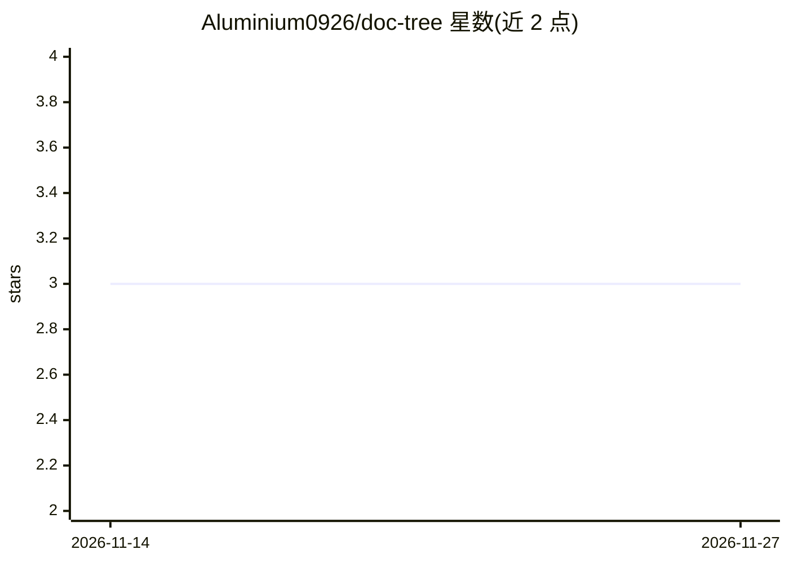

# Aluminium0926/doc-tree

⭐ 3 · JavaScript · MIT · 推送 2026-11-26 · [GitHub](https://github.com/Aluminium0926/doc-tree) · 个人维护 · 中文 README

**给读文档的人用：划词向 AI 提问且问答锚定原文可回看**

本地优先的文档阅读与提问工具：支持 PDF/Word/Markdown/纯文本，用户选中文本即可向自配模型提问，回答与追问组成锚定原文页码与句子的提问树，可在回答内继续选中追问。提供网页 PWA、Windows/macOS Electron 便携包与安卓 APK，数据存浏览器 IndexedDB 或本地 data/ 目录。不提供模型服务，需用户自行配置 Base URL/API Key；扫描版 PDF 需改用框选截图提问。

## 筛选速览

| 维度 | 判定 | 备注 |
|---|---|---|
| AI 角色 | `ai-native` | 本体是模型或模型工具 |
| 许可风险 | `permissive` | MIT |
| 部署形态 | `desktop` | 安装包/桌面程序 |
| 模型依赖 | locked-api |  |
| 硬件要求 | — | 无带数字的原话,不猜 |
| 安装摩擦 | `low` | 无编译、无系统依赖或容器化 |
| 成熟度 | — | 结构信号不足 |

## 能力要点

- 划词提问与追问树：节点锚定原文页码/句子，可折叠、导出 Markdown
- 上下文组装：全文摘要+前后文+跨页检索+祖先链；function calling 读取原文
- 多端：PWA/Windows/macOS/安卓 APK，数据本地存储，无需联网服务端
- 支持 OpenAI 兼容与 Anthropic 原生接口，文本与视觉可用不同服务商

## 适用场景

- 读论文或课件时选中不懂的句子直接向 AI 提问
- 下次翻回同一页时回看当时的问答
- 局域网内让手机访问本地服务阅读大 PDF

## 场景标签

`文档问答` · 领域:知识与检索

## 证据(README 行号)

> L9: 每个问题都记着自己锚在原文第几页、哪一句，长成一棵树，而不是一条滚不到头的聊天记录。
> L48: |文档阅读|PDF 按页原版式渲染，文字层可选中；Word / Markdown / 纯文本重排阅读|
> L265: 本项目仅为本地文档阅读与提问工具，不提供任何模型服务，也不代表任何模型厂商。

## 星数曲线

2026-11-14 3 → 2026-11-27 3（+0）

---
*卡片 v1 · prompt 1.4 · 生成 2026-11-22 · 置信度 high · 依据 README sha `2b224a4827b8` · [字段定义](../../DATASET.md)*
