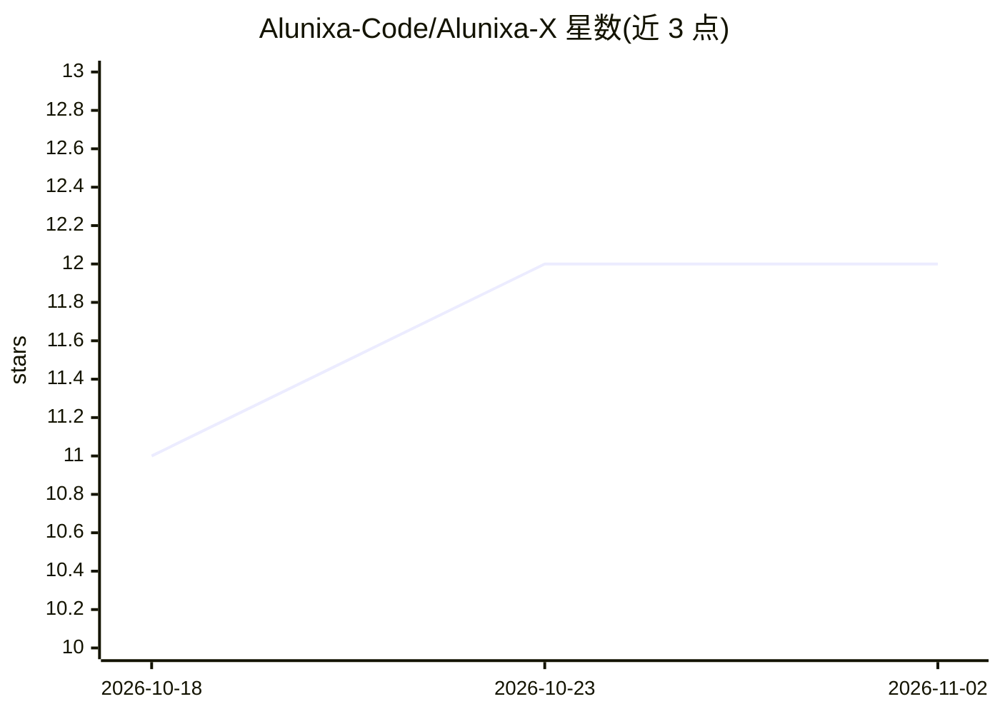

# Alunixa-Code/Alunixa-X

⭐ 12 · Rust · AGPL-3.0 · 推送 2026-10-23 · [GitHub](https://github.com/Alunixa-Code/Alunixa-X) · [官网](https://github.com/Alunixa-Code/Alunixa-X/releases/latest) · 个人维护 · 中文 README

**桌面 AI Agent 控制系统：统一管理 Codex 的供应商、模型与工具**

基于 Rust/Tauri 的跨平台桌面程序，围绕 OpenAI Codex / ChatGPT Desktop 提供管理：供应商配置（官方登录、混合 API、纯 API、聚合路由）、逐模型协议选择（Responses/Chat/Completions/Anthropic Messages/Gemini，经本地协议代理转换）、MCP/Skills/Plugins 管理、独立 image_gen MCP 生图、会话管理、微信/远控/Zed 连接与动态壁纸。通过外部启动器、CDP、本地 helper 与协议代理接管 Codex；不含 Codex 本体，需先安装。Windows/macOS 提供安装包，不提供 Linux 包。

## 筛选速览

| 维度 | 判定 | 备注 |
|---|---|---|
| AI 角色 | `ai-ecosystem` | LLM/agent 周边工具 |
| 许可风险 | `viral` | AGPL-3.0 |
| 部署形态 | `desktop` | 安装包/桌面程序 |
| 模型依赖 | locked-api |  |
| 硬件要求 | — | 无带数字的原话,不猜 |
| 安装摩擦 | `low` | 无编译、无系统依赖或容器化 |
| 成熟度 | — | 结构信号不足 |

## 能力要点

- 三种接入模式：官方登录、官方混合 API、纯 API，支持聚合轮转与故障转移
- 逐模型协议选择，经本地 Responses 代理路由到不同上游协议
- 独立 image_gen MCP 支持多组图片 API 与默认模型排序
- MCP、Skills、Plugins 独立管理与扩展市场

## 适用场景

- 在一个界面里管理 Codex 的多个模型供应商与 API Key
- 为 Codex 接入 Anthropic/Gemini 等非官方协议的第三方模型服务
- 给 Codex 挂载生图 MCP 与自定义模型目录

## 场景标签

`模型网关` `图像生成` · 领域:Agent 开发

## 证据(README 行号)

> L97: Alunixa X 是面向桌面 AI Agent 的跨平台控制系统。当前版本重点连接 OpenAI Codex / ChatGPT Desktop，主要通过外部启动器、CDP、本地 helper 与协议代理提供统一管理能力；可选原
> L104: 供应商 → 模型 → 上下文 → MCP / Skills / Plugins → Codex → 桌面运行时

## 星数曲线

2026-10-18 11 → 2026-11-02 12（+1）

---
*卡片 v1 · prompt 1.4 · 生成 2026-11-01 · 置信度 high · 依据 README sha `ed859a43f08f` · [字段定义](../../DATASET.md)*
