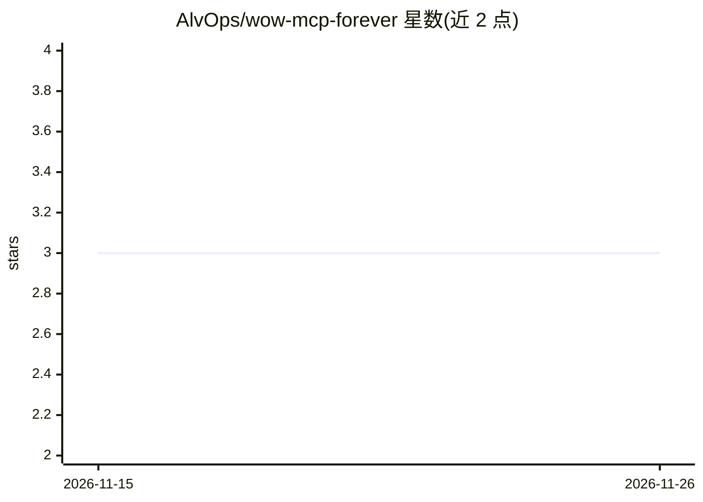

# AlvOps/wow-mcp-forever

⭐ 3 · TypeScript · MIT · 推送 2026-10-13 · [GitHub](https://github.com/AlvOps/wow-mcp-forever) · 个人维护

**给 AI 助手接入 WoW Forever 游戏数据的 MCP 服务器**

基于 Wowhead Forever 数据库的 MCP 服务器，让 AI 助手回答《魔兽世界：Forever》相关问题。提供 4 个工具：一步式查询（掉落/出售/任务起点）、按名搜索、实体摘要与完整页面数据，覆盖 15 种实体类型。每条响应带可引用的 Wowhead 来源 URL；输出经质量调整：补区域名、按样本量排序掉落表、默认省略冗余表。因 Wowhead 无官方 API，服务器解析站点端点，并用无头 Chromium 生成 aws-waf-token 以通过 AWS WAF 验证。需 Node.js 20+ 与 Chromium，响应缓存一小时。

## 筛选速览

| 维度 | 判定 | 备注 |
|---|---|---|
| AI 角色 | `ai-ecosystem` | LLM/agent 周边工具 |
| 许可风险 | `permissive` | MIT |
| 部署形态 | `self-host` | docker 或自建部署 |
| 模型依赖 | — | README 未给出锁定关系 |
| 硬件要求 | — | 无带数字的原话,不猜 |
| 安装摩擦 | `low` | 无编译、无系统依赖或容器化 |
| 成熟度 | — | 结构信号不足 |

## 能力要点

- 4 个 MCP 工具覆盖搜索、摘要与完整数据表查询，15 种实体类型
- 每条响应附带可引用的 Wowhead 来源 URL
- 无头 Chromium 自动生成 aws-waf-token 应对 AWS WAF 挑战并重试
- 掉落表按样本量排序、canonical 链接校验等数据质量机制

## 适用场景

- 在 AI 助手中查询 WoW Forever 物品掉落与出售来源
- 让 AI 助手检索任务起点与奖励信息
- 本地或 HTTP 模式部署给支持 MCP 的客户端使用

## 场景标签

 · 领域:游戏/AI 工具集成

## 证据(README 行号)

> L3: An MCP server that lets an AI assistant answer questions about **World of Warcraft: Forever** using the Wowhead Fore
> L44: ## Connect to Hermes Agent

## 星数曲线

2026-11-15 3 → 2026-11-26 3（+0）

---
*卡片 v1 · prompt 1.4 · 生成 2026-11-22 · 置信度 high · 依据 README sha `546d101c71cb` · [字段定义](../../DATASET.md)*
