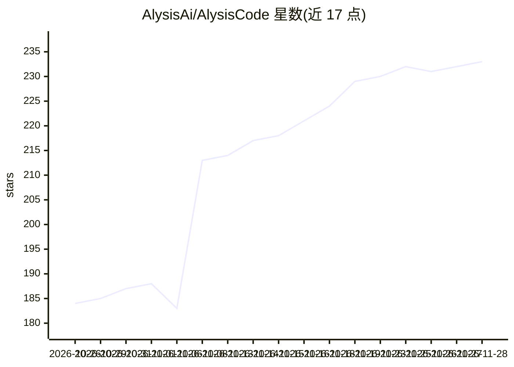

# AlysisAi/AlysisCode

⭐ 233 · Python · Apache-2.0 · 推送 2026-11-27 · [GitHub](https://github.com/AlysisAi/AlysisCode) · [官网](https://alysiscode.com/) · 组织维护

**面向桌面用户的 AI agent 应用：写代码、做文档、托管例行任务**

Alysis 是一个桌面 AI 助手应用，内置三类 agent：Code owls 在用户项目中构建、修复并测试软件，支持变更检查点回滚；Work owls 将笔记、文件与研究内容生成文档、表格、幻灯片和 PDF；Owls 可在本地、云端或 Android 上携带记忆与例程持续执行任务。引擎以 Apache-2.0 开源在本仓库，含 CLI、VS Code 扩展与 JetBrains 预览。模型可选 Claude、GPT、Gemini、DeepSeek 或通过 Ollama/LM Studio 使用本地模型，可自带 API key。Shell 命令默认在沙箱中运行，对外发布类操作需用户批准。

## 筛选速览

| 维度 | 判定 | 备注 |
|---|---|---|
| AI 角色 | `ai-native` | 本体是模型或模型工具 |
| 许可风险 | `permissive` | Apache-2.0 |
| 部署形态 | `library` | 以包/库形式分发 |
| 模型依赖 | local-ok | 支持本地模型 |
| 硬件要求 | — | 无带数字的原话,不猜 |
| 安装摩擦 | `low` | 无编译、无系统依赖或容器化 |
| 成熟度 | — | 结构信号不足 |

## 能力要点

- 三类 agent：代码构建/修复/测试、文档与幻灯片生成、带记忆与例程的持续任务
- 支持 Claude/GPT/Gemini/DeepSeek 及 Ollama、LM Studio 本地模型，可自带 key
- Shell 命令默认沙箱执行，对外操作需用户批准
- 引擎 Apache-2.0 开源，提供桌面应用与 CLI 两种形态

## 适用场景

- 在本地项目中让 agent 写代码、修 bug 并跑测试
- 把笔记和研究资料转成文档、表格或幻灯片
- 设置例程任务让 agent 在本机或云端持续执行

## 场景标签

`AI 助手` `编码 Agent` `AI 写作` · 领域:编码与开发

## 证据(README 行号)

> L9:  Alysis is an AI assistant for your desktop: a team of AI agents (owls) that write, research, build software and kee
> L33: > **Any AI model, no lock-in.** Use Claude, GPT, Gemini, DeepSeek or a local model with Ollama or LM Studio. Bring 

## 星数曲线

2026-10-26 184 → 2026-11-28 233（+49）

---
*卡片 v1 · prompt 1.4 · 生成 2026-11-28 · 置信度 high · 依据 README sha `057d722f1e80` · [字段定义](../../DATASET.md)*
