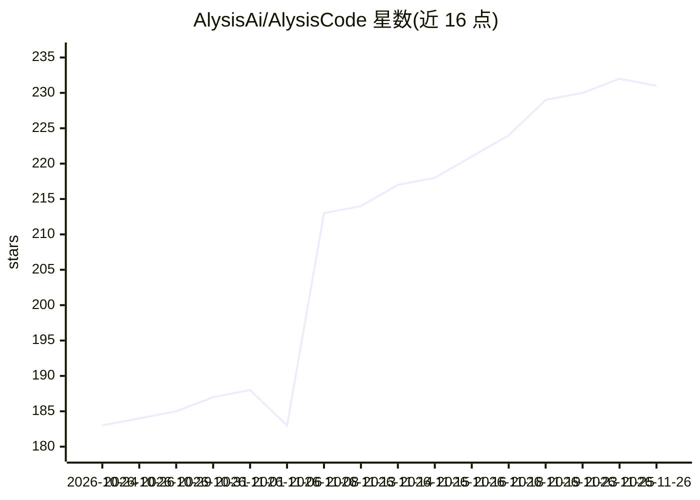

# AlysisAi/AlysisCode

⭐ 231 · Python · Apache-2.0 · 推送 2026-11-25 · [GitHub](https://github.com/AlysisAi/AlysisCode) · [官网](https://alysiscode.com/) · 组织维护

**桌面应用：集成代码构建、文档生成与任务委托 AI 助手**

单一桌面应用集成三个组件：Alysis Code 用于构建与审查软件（内置终端、检查变更、回滚检查点）；Alysis Work 将笔记与研究材料生成 Word、表格、演示文稿与 PDF；Alysis Owls 将持续性任务委托给带持久记忆与例程的个人助手。模型可自选：Alysis 账户、自有 API key 或本地模型。动作涉及对外发送、支付、发布或删除时助手先请求批准，shell 命令默认沙箱。桌面端提供 macOS/Windows 安装包，引擎与 CLI 以 Apache-2.0 开源，支持 macOS/Linux/Windows 终端安装。

## 筛选速览

| 维度 | 判定 | 备注 |
|---|---|---|
| AI 角色 | `ai-native` | 本体是模型或模型工具 |
| 许可风险 | `permissive` | Apache-2.0 |
| 部署形态 | `library` | 以包/库形式分发 |
| 模型依赖 | — | README 未给出锁定关系 |
| 硬件要求 | — | 无带数字的原话,不猜 |
| 安装摩擦 | `low` | 无编译、无系统依赖或容器化 |
| 成熟度 | — | 结构信号不足 |

## 能力要点

- Code/Work/Owls 三个组件：编码、文档生成、持续任务委托
- 自选模型：账户、自有 API key 或本地模型
- 内置 web 搜索与 computer use 跨应用操作
- shell 命令与验证命令默认严格沙箱，敏感动作需批准

## 适用场景

- 在一个桌面应用里完成编码、调试与代码审查
- 把笔记和资料生成 Word、表格、演示文稿或 PDF
- 把持续例程任务委托给带记忆的助手并保持上下文

## 场景标签

`编码 Agent` `代码审查` `AI 助手` `GUI 自动化` · 领域:效率与自动化

## 证据(README 行号)

> L5:  Build software with Alysis Code, create documents with Alysis Work, and delegate ongoing tasks to Alysis Owls — all
> L28: |**Alysis Code**|Build, debug, and review software. Work with your repositories, inspect changes, run commands in t
> L36: - **Choose your models.** Use an Alysis account, bring your own API keys, or connect local models.

## 星数曲线

2026-10-24 183 → 2026-11-26 231（+48）

---
*卡片 v1 · prompt 1.4 · 生成 2026-11-25 · 置信度 mid · 依据 README sha `366d72024958` · [字段定义](../../DATASET.md)*
