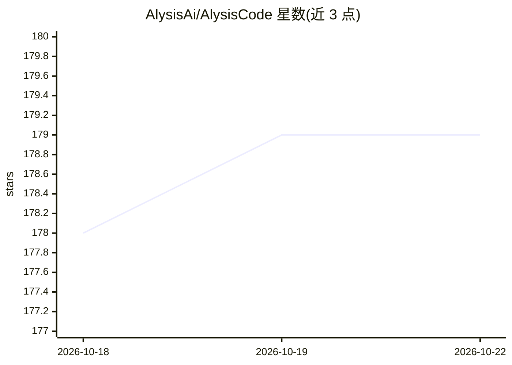

# AlysisAi/AlysisCode

⭐ 179 · Python · Apache-2.0 · 推送 2026-10-21 · [GitHub](https://github.com/AlysisAi/AlysisCode) · [官网](https://alysiscode.com/) · 组织维护

**本地 CLI 编码 agent：自带模型、沙箱隔离，产出可审 PR 代码**

终端编码 agent，运行于 macOS/Linux/Windows（Python 3.11+），通过交互 chat 或一次性 run 命令执行编码任务。支持接入自有 API key（OpenAI、Anthropic、DeepSeek、Qwen、Gemini 等）或本地端点（Ollama、LM Studio、vLLM）离线运行。机制包括 Forge Mode 计划驱动执行与并行子 agent、Docker/Bubblewrap 沙箱与内置拒绝清单、四级权限模式（readonly/review/auto/fullaccess）与四种 persona。Apache-2.0 许可，另提供 VS Code 与 JetBrains（预览）集成。

## 筛选速览

| 维度 | 判定 | 备注 |
|---|---|---|
| AI 角色 | `ai-ecosystem` | LLM/agent 周边工具 |
| 许可风险 | `permissive` | Apache-2.0 |
| 部署形态 | `library` | 以包/库形式分发 |
| 模型依赖 | local-ok | 支持本地模型 |
| 硬件要求 | — | 无带数字的原话,不猜 |
| 安装摩擦 | `low` | 无编译、无系统依赖或容器化 |
| 成熟度 | — | 结构信号不足 |

## 能力要点

- Forge Mode 计划驱动执行：规划、并行派发 worker、逐任务验证
- 沙箱默认开启：Docker/Bubblewrap 隔离与常驻拒绝清单（rm -rf /、curl|sh、sudo）
- Bring your own model：多家 API 供应商与本地端点（Ollama/LM Studio/vLLM）离线运行
- 四级权限模式 + 可自定义 persona 的双层控制

## 适用场景

- 在终端用自然语言让 agent 修复失败测试或实现功能
- 计划驱动地拆解并并行执行较大的编码任务
- 在沙箱隔离下让 agent 自动执行 shell 与文件修改

## 场景标签

`编码 Agent` · 领域:编码与开发

## 证据(README 行号)

> L3:  Local CLI coding agent that turns plans into reviewed, PR-ready code.
> L67: Bring your own key from any supported provider — or point Alysis Code at a local endpoint (Ollama,

## 星数曲线

2026-10-18 178 → 2026-10-22 179（+1）

---
*卡片 v1 · prompt 1.4 · 生成 2026-10-22 · 置信度 high · 依据 README sha `a70de1d1cede` · [字段定义](../../DATASET.md)*
